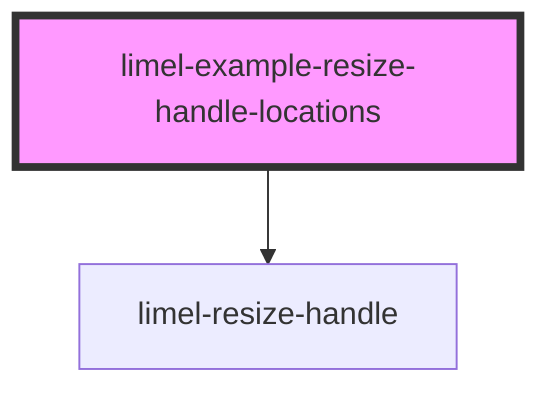

<!-- Auto Generated Below -->

## Overview

Locations

The handle can be on any edge of the element that it resizes. Set the
location with `location`. The handle resizes the width when it is on the
left or the right, and the height when it is at the top or the bottom. In
this example, each element shows the `location` of its handle, and the
`value` of the handle, which is the width or the height in pixels.

Arrow keys move the handle in the same way as the pointer does. For example,
<kbd>↑</kbd> makes the element higher when the handle is at the top, and
<kbd>↓</kbd> makes it lower.

## Dependencies

### Depends on

- [limel-resize-handle](..)

### Graph

----------------------------------------------

*Built with [StencilJS](https://stenciljs.com/)*
