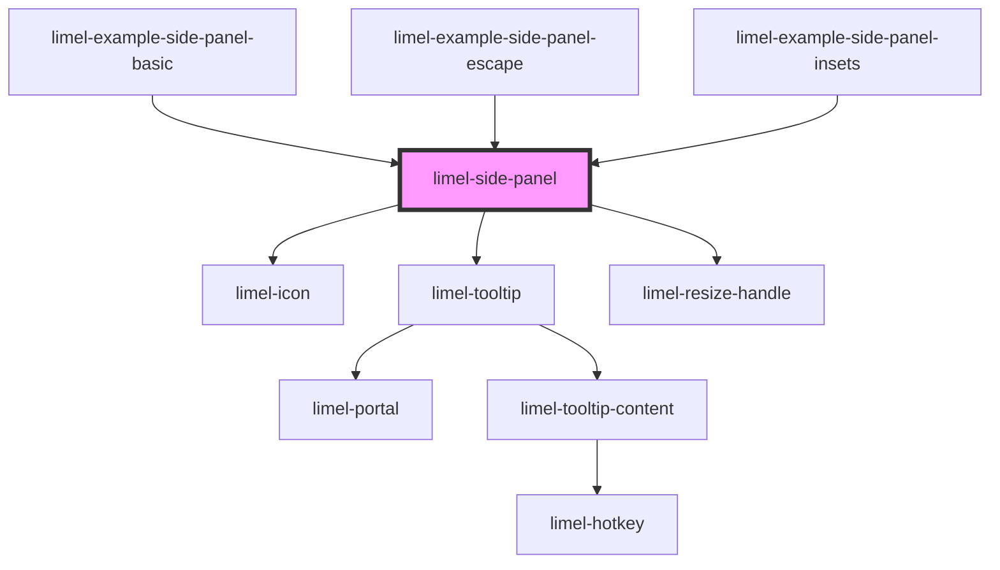

<!-- Auto Generated Below -->

## Overview

A resizable panel that is displayed on top of the right side of the page.
The content is placed in the default slot, below a toolbar with a close button.

The panel is positioned relative to its nearest positioned ancestor. Set
`position: relative` on that element. Use `--side-panel-top-inset`,
`--side-panel-right-inset` and `--side-panel-bottom-inset` to keep parts of
that element visible, for example a header.

The CSS custom properties can be set on the panel or on any ancestor.

The panel is a dialog that does not block the rest of the page. Set `label`
to give it an accessible name, which screen readers announce. When the panel
opens, focus moves into it. When the panel is removed, focus returns to the
element that had it before, unless focus is somewhere else by then.

The panel emits `close` when the user clicks the close button, or presses
Escape. It does not remove itself. The consumer must remove it from the DOM.
The user can resize the panel by dragging its left edge, or with the arrow
keys. The panel emits `changeWidth` when a resize is finished.

See the examples for how closing and resizing work in detail.

## Properties

| Property        | Attribute         | Description                                                                                                                                               | Type      | Default     |
| --------------- | ----------------- | --------------------------------------------------------------------------------------------------------------------------------------------------------- | --------- | ----------- |
| `closeLabel`    | `close-label`     | Label of the close button. Shown as a tooltip and used as the accessible name.                                                                            | `string`  | `'Close'`   |
| `closeOnEscape` | `close-on-escape` | Whether pressing Escape emits `close`. Set to `false` to let only the close button emit `close`. The panel then does not prevent the Escape event either. | `boolean` | `true`      |
| `label`         | `label`           | Accessible name of the panel. Screen readers announce it. Set it to something that tells the user what the panel is for.                                  | `string`  | `undefined` |
| `resizeLabel`   | `resize-label`    | Label of the resize handle. Used as the accessible name.                                                                                                  | `string`  | `'Resize'`  |

## Events

| Event         | Description                                                                                                                                                                                                                                    | Type                  |
| ------------- | ---------------------------------------------------------------------------------------------------------------------------------------------------------------------------------------------------------------------------------------------- | --------------------- |
| `changeWidth` | Emitted when the user has finished a resize that changed the width. The detail is the new width in pixels. The panel already uses the new width. Store the value to restore the width with `--side-panel-width` the next time the panel opens. | `CustomEvent<number>` |
| `close`       | Emitted when the close button is clicked, or when Escape is pressed and `closeOnEscape` is `true`.                                                                                                                                             | `CustomEvent<void>`   |

## Dependencies

### Used by

 - [limel-example-side-panel-basic](examples)
 - [limel-example-side-panel-escape](examples)
 - [limel-example-side-panel-insets](examples)

### Depends on

- [limel-icon](../icon)
- [limel-tooltip](../tooltip)
- [limel-resize-handle](../resize-handle)

### Graph

----------------------------------------------

*Built with [StencilJS](https://stenciljs.com/)*
