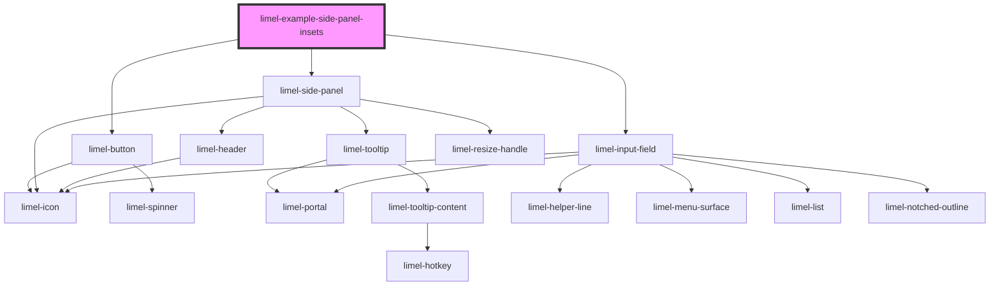

<!-- Auto Generated Below -->

## Overview

Keeping parts of the page visible

By default, the panel covers the full height of its positioned ancestor,
along the right edge. Use `--side-panel-top-inset`, `--side-panel-right-inset`
and `--side-panel-bottom-inset` to keep parts of that element visible.

In this example, the insets keep the header and the dock visible while the
panel is open.

## Dependencies

### Depends on

- [limel-button](../../button)
- [limel-side-panel](..)
- [limel-input-field](../../input-field)

### Graph

----------------------------------------------

*Built with [StencilJS](https://stenciljs.com/)*
