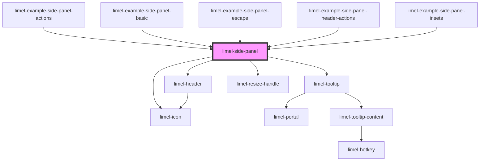

<!-- Auto Generated Below -->


## Overview

A resizable panel that is displayed on top of the right side of the page.
The content is placed in the default slot, below a toolbar and a header.

The panel is positioned relative to its nearest positioned ancestor. Set
`position: relative` on that element. Use `--side-panel-top-inset`,
`--side-panel-right-inset` and `--side-panel-bottom-inset` to keep parts of
that element visible, for example a header.

The CSS custom properties can be set on the panel or on any ancestor.

The panel is a dialog that does not block the rest of the page. Set `label`
to give it an accessible name, which screen readers announce. When the panel
opens, focus moves into it. When the panel is removed, focus returns to the
element that had it before, unless focus is somewhere else by then.

The panel emits `close` when the user clicks the close button, or presses
Escape. It does not remove itself. The consumer must remove it from the DOM.
The user can resize the panel by dragging its left edge, or with the arrow
keys. The panel emits `changeWidth` when a resize is finished.

See the examples for how closing and resizing work in detail.

## Header

The header shows the heading, subheading and icon of the last entry in
`stack`. When the entry has a `color`, the header gets that background color,
and the headings are white with a text shadow. When `stack` is empty, the
panel has no header.

Put controls for the header, for example a follow button or a menu, in the
`header-actions` slot. They are shown at the right end of the header. When
`stack` is empty, there is no header, and the slot content is not shown.

The slot is for small controls. It is at most half as wide as the header,
and at most as tall as the heading and subheading together. Larger content
is cut off, so that the header keeps its size.

The slot content is not tied to an entry in `stack`. When the last entry
changes, the consumer must also change the slot content.

The slot content keeps its own colors. Use `--side-panel-header-text-color`
to match the text color of the header. It is white when the header has a
`color`. It can also be used as the `color` of an `Icon`.

## Actions

The toolbar has a close button on the left. Other buttons are set with
`actions`, and are shown on the right. The `type` of an action decides its
icon. When the user clicks an action, the panel emits `selectAction` with the
`id` of the action and the click event. The consumer decides what the action
does.

An action with an `href` is a link, so the user can open it in a new tab.
To handle the navigation in another way, for example with the router of the
application, call `preventDefault` on the click event in `selectAction`. Do
this only for a plain click with the primary button. Let the browser handle
all other clicks, so that Ctrl-click and Cmd-click still open the link in a
new tab:

```ts
function handleSelectAction(event: CustomEvent<SidePanelActionSelect>) {
    const click = event.detail.event;
    const isPlainClick =
        click.button === 0 &&
        !click.metaKey &&
        !click.ctrlKey &&
        !click.shiftKey &&
        !click.altKey;
    if (!isPlainClick) {
        return;
    }

    click.preventDefault();
    router.navigate(event.detail.id);
}
```

## Properties

| Property        | Attribute         | Description                                                                                                                                               | Type                | Default     |
| --------------- | ----------------- | --------------------------------------------------------------------------------------------------------------------------------------------------------- | ------------------- | ----------- |
| `actions`       | --                | Buttons in the toolbar, to the right of the close button.                                                                                                 | `SidePanelAction[]` | `[]`        |
| `closeLabel`    | `close-label`     | Label of the close button. Shown as a tooltip and used as the accessible name.                                                                            | `string`            | `'Close'`   |
| `closeOnEscape` | `close-on-escape` | Whether pressing Escape emits `close`. Set to `false` to let only the close button emit `close`. The panel then does not prevent the Escape event either. | `boolean`           | `true`      |
| `label`         | `label`           | Accessible name of the panel. Screen readers announce it. Set it to something that tells the user what the panel is for.                                  | `string`            | `undefined` |
| `resizeLabel`   | `resize-label`    | Label of the resize handle. Used as the accessible name.                                                                                                  | `string`            | `'Resize'`  |
| `stack`         | --                | The panels in the stack, outermost first. The last entry is the panel that is displayed. Its heading, subheading and icon are shown in the header.        | `SidePanelEntry[]`  | `[]`        |


## Events

| Event          | Description                                                                                                                                                                                                                                    | Type                                 |
| -------------- | ---------------------------------------------------------------------------------------------------------------------------------------------------------------------------------------------------------------------------------------------- | ------------------------------------ |
| `changeWidth`  | Emitted when the user has finished a resize that changed the width. The detail is the new width in pixels. The panel already uses the new width. Store the value to restore the width with `--side-panel-width` the next time the panel opens. | `CustomEvent<number>`                |
| `close`        | Emitted when the close button is clicked, or when Escape is pressed and `closeOnEscape` is `true`.                                                                                                                                             | `CustomEvent<void>`                  |
| `selectAction` | Emitted when an action in the toolbar is clicked. The detail has the `id` of the action, or its `type` if it has no `id`, and the click event.                                                                                                 | `CustomEvent<SidePanelActionSelect>` |


## Slots

| Slot               | Description                                                                                                                                |
| ------------------ | ------------------------------------------------------------------------------------------------------------------------------------------ |
|                    | Content of the panel                                                                                                                       |
| `"header-actions"` | Small controls at the right end of the header. Content that is larger than half the header width or the height of the headings is cut off. |


## Dependencies

### Used by

 - [limel-example-side-panel-actions](examples)
 - [limel-example-side-panel-basic](examples)
 - [limel-example-side-panel-escape](examples)
 - [limel-example-side-panel-header-actions](examples)
 - [limel-example-side-panel-insets](examples)

### Depends on

- [limel-icon](../icon)
- [limel-tooltip](../tooltip)
- [limel-header](../header)
- [limel-resize-handle](../resize-handle)

### Graph


----------------------------------------------

*Built with [StencilJS](https://stenciljs.com/)*
