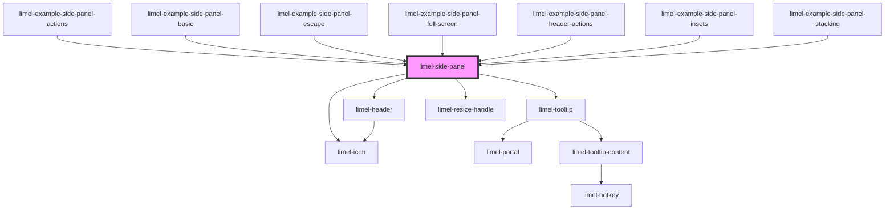

<!-- Auto Generated Below -->

## Overview

A resizable panel that is displayed on top of the right side of the page.
It does not block the rest of the page. Place it in an element with
`position: relative`.

The panel has:
- a toolbar with a close button, and buttons from `actions`
- a header that shows the last entry of `stack`, with a slot for controls
- backs behind its left edge, for the other entries of `stack`
- a handle on its left edge, to resize the panel
- a full screen mode, for small screens

The panel emits `close`, but does not remove itself. The consumer must
remove it from the DOM.

Each example shows one feature in detail, and when to use it.

## Properties

| Property        | Attribute         | Description                                                                                                                                                                                                                    | Type                | Default     |
| --------------- | ----------------- | ------------------------------------------------------------------------------------------------------------------------------------------------------------------------------------------------------------------------------ | ------------------- | ----------- |
| `actions`       | --                | Buttons in the toolbar, to the right of the close button.                                                                                                                                                                      | `SidePanelAction[]` | `[]`        |
| `closeLabel`    | `close-label`     | Label of the close button. Shown as a tooltip and used as the accessible name.                                                                                                                                                 | `string`            | `'Close'`   |
| `closeOnEscape` | `close-on-escape` | Whether pressing Escape emits `close`. Set to `false` to let only the close button emit `close`. The panel then does not prevent the Escape event either.                                                                      | `boolean`           | `true`      |
| `fullScreen`    | `full-screen`     | Set to `true` when the screen is too narrow for the panel to be displayed on top of the page. The panel then covers the full width of the positioned ancestor. It cannot be resized, and the backs of the stack are not shown. | `boolean`           | `false`     |
| `label`         | `label`           | Accessible name of the panel. Screen readers announce it. Set it to something that tells the user what the panel is for.                                                                                                       | `string`            | `undefined` |
| `resizeLabel`   | `resize-label`    | Label of the resize handle. Used as the accessible name.                                                                                                                                                                       | `string`            | `'Resize'`  |
| `stack`         | --                | The panels in the stack, outermost first. The last entry is the panel that is displayed. Its heading, subheading and icon are shown in the header. The other entries are shown as backs behind the panel.                      | `SidePanelEntry[]`  | `[]`        |

## Events

| Event              | Description                                                                                                                                                                                                                                    | Type                                 |
| ------------------ | ---------------------------------------------------------------------------------------------------------------------------------------------------------------------------------------------------------------------------------------------- | ------------------------------------ |
| `changeWidth`      | Emitted when the user has finished a resize that changed the width. The detail is the new width in pixels. The panel already uses the new width. Store the value to restore the width with `--side-panel-width` the next time the panel opens. | `CustomEvent<number>`                |
| `close`            | Emitted when the close button is clicked, or when Escape is pressed and `closeOnEscape` is `true`.                                                                                                                                             | `CustomEvent<void>`                  |
| `selectAction`     | Emitted when an action in the toolbar is clicked. The detail has the `id` of the action, or its `type` if it has no `id`, and the click event.                                                                                                 | `CustomEvent<SidePanelActionSelect>` |
| `selectStackEntry` | Emitted when a back of the stack is clicked. The detail is the index of its entry in `stack`.                                                                                                                                                  | `CustomEvent<number>`                |

## Slots

| Slot               | Description                                                                                                                                |
| ------------------ | ------------------------------------------------------------------------------------------------------------------------------------------ |
|                    | Content of the panel                                                                                                                       |
| `"header-actions"` | Small controls at the right end of the header. Content that is larger than half the header width or the height of the headings is cut off. |

## Dependencies

### Used by

 - [limel-example-side-panel-actions](examples)
 - [limel-example-side-panel-basic](examples)
 - [limel-example-side-panel-escape](examples)
 - [limel-example-side-panel-full-screen](examples)
 - [limel-example-side-panel-header-actions](examples)
 - [limel-example-side-panel-insets](examples)
 - [limel-example-side-panel-stacking](examples)

### Depends on

- [limel-icon](../icon)
- [limel-tooltip](../tooltip)
- [limel-header](../header)
- [limel-resize-handle](../resize-handle)

### Graph

----------------------------------------------

*Built with [StencilJS](https://stenciljs.com/)*
