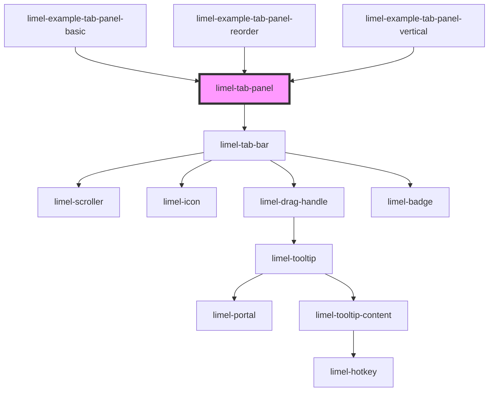

<!-- Auto Generated Below -->

## Overview

The `limel-tab-panel` component uses the `limel-tab-bar` component together
with custom slotted components and will display the content for the currently
active tab. Each slotted component must have an id equal to the id of the
corresponding tab it belongs to. These components should implement the
[TabPanelComponent](#/type/TabPanelComponent/) interface.

The `limel-tab-panel` component will automatically set each tab configuration
on the corresponding slotted component as a property named `tab` so that the
component can take action upon that. Sometimes it might be desirable to not
load data or render anything until the tab is active.

The slotted components can also emit the `changeTab` event to update anything
inside the actual tab, e.g. to change the icon, color or badge.

Set `allowTabReorder` to let the user reorder the tabs by dragging them. The
panel does not change `tabs` itself. Listen for `reorderTab`, and give the
panel the tabs in their new order. The tabs can be reordered with a mouse
and a touch screen, but not yet with the keyboard.

## Properties

| Property          | Attribute           | Description                                                                                                                              | Type                         | Default        |
| ----------------- | ------------------- | ---------------------------------------------------------------------------------------------------------------------------------------- | ---------------------------- | -------------- |
| `allowTabReorder` | `allow-tab-reorder` | Set to `true` to let the user reorder the tabs by dragging them. Listen for `reorderTab` and give the panel the tabs in their new order. | `boolean`                    | `false`        |
| `orientation`     | `orientation`       | Whether the tabs are laid out in a row, above the content, or in a column, to the left of it.                                            | `"horizontal" \| "vertical"` | `'horizontal'` |
| `tabs`            | --                  | The tabs to display in the panel                                                                                                         | `Tab[]`                      | `[]`           |

## Events

| Event        | Description                                                                                                                                                                     | Type                           |
| ------------ | ------------------------------------------------------------------------------------------------------------------------------------------------------------------------------- | ------------------------------ |
| `changeTab`  | Emitted when a tab has been changed                                                                                                                                             | `CustomEvent<Tab>`             |
| `reorderTab` | Emitted when the user has dragged a tab to a new place. The panel does not change `tabs` itself. The tab stays where it was until `tabs` is set to the tabs in their new order. | `CustomEvent<TabReorderEvent>` |

## Slots

| Slot | Description                                                                                                                              |
| ---- | ---------------------------------------------------------------------------------------------------------------------------------------- |
|      | Content to put inside the `limel-tab-panel`. Each slotted element must have the `id` attribute equal to the id of the tab it belongs to. |

## Dependencies

### Used by

 - [limel-example-tab-panel-basic](examples)
 - [limel-example-tab-panel-reorder](examples)
 - [limel-example-tab-panel-vertical](examples)

### Depends on

- [limel-tab-bar](../tab-bar)

### Graph

----------------------------------------------

*Built with [StencilJS](https://stenciljs.com/)*
