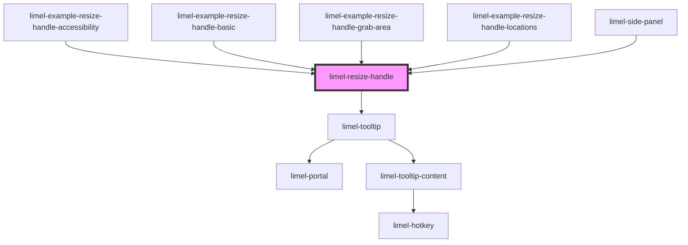

<!-- Auto Generated Below -->

## Overview

A handle on an edge of an element. The user drags the handle, or presses an
arrow key while the handle has focus, to resize the element.

The handle does not resize the element. It emits `changeSize` with the size
that the user asks for, and the consumer applies it.

The handle must be a direct child of the element that it resizes. When the
handle is placed directly in a shadow root, it resizes the element that has
the shadow root. It has `position: absolute` and `z-index: 1`, and sits on
the edge that `location` names. Give the element a `position` other than
`static`. If other content covers the handle, also give the element
`isolation: isolate`.

## Accessibility
The user reaches the handle with the <kbd>Tab</kbd> key. The handle is named
"Resize" followed by `resizableRegionLabel`, for example "Resize side
panel". A tooltip shows the name and how to resize. While the pointer is
over the handle, it says to drag the handle. While the handle has keyboard
focus, it says which arrow keys to press, which fit `location`. Screen
readers read the arrow keys as the description of the handle.

## Properties

| Property               | Attribute                | Description                                                                                                                                                                                                                                                                                                                                                                                                              | Type                                                                   | Default     |
| ---------------------- | ------------------------ | ------------------------------------------------------------------------------------------------------------------------------------------------------------------------------------------------------------------------------------------------------------------------------------------------------------------------------------------------------------------------------------------------------------------------ | ---------------------------------------------------------------------- | ----------- |
| `language`             | `language`               | Defines the language for translations.                                                                                                                                                                                                                                                                                                                                                                                   | `"da" \| "de" \| "en" \| "fi" \| "fr" \| "nb" \| "nl" \| "no" \| "sv"` | `'en'`      |
| `location`             | `location`               | The location of the handle relative to the resizable element.                                                                                                                                                                                                                                                                                                                                                            | `"bottom" \| "left" \| "right" \| "top"`                               | `'left'`    |
| `max`                  | `max`                    | The largest size that the element can have, in pixels.                                                                                                                                                                                                                                                                                                                                                                   | `number`                                                               | `undefined` |
| `min`                  | `min`                    | The smallest size that the element can have, in pixels.                                                                                                                                                                                                                                                                                                                                                                  | `number`                                                               | `undefined` |
| `resizableRegionLabel` | `resizable-region-label` | The name of the region that the handle resizes, for example `side panel`. The accessible name of the handle is "Resize" followed by this name, for example "Resize side panel". When no name is set, the handle is named "Resize this region".  Write the name in the language that is set in `language`, in the form that reads right after "Resize", for example `side panel` in English and `sidopanelen` in Swedish. | `string`                                                               | `undefined` |
| `value`                | `value`                  | The size of the element, in pixels: the width when `location` is `left` or `right`, and the height when it is `top` or `bottom`.                                                                                                                                                                                                                                                                                         | `number`                                                               | `undefined` |

## Events

| Event        | Description                                                                                                                                                                                                                  | Type                  |
| ------------ | ---------------------------------------------------------------------------------------------------------------------------------------------------------------------------------------------------------------------------- | --------------------- |
| `changeSize` | Emitted on each pointer move during a drag, and on each arrow key press. The detail is the size that the user asks for, in pixels. The consumer limits it, uses it, and sets the result as `value`.                          | `CustomEvent<number>` |
| `endResize`  | Emitted after the last `changeSize` when the user has finished a resize: when the pointer is released after it has moved, and after each arrow key press. Pressing and releasing the handle without moving it emits nothing. | `CustomEvent<void>`   |

## Dependencies

### Used by

 - [limel-example-resize-handle-accessibility](examples)
 - [limel-example-resize-handle-basic](examples)
 - [limel-example-resize-handle-grab-area](examples)
 - [limel-example-resize-handle-locations](examples)
 - [limel-side-panel](../side-panel)

### Depends on

- [limel-tooltip](../tooltip)

### Graph

----------------------------------------------

*Built with [StencilJS](https://stenciljs.com/)*
