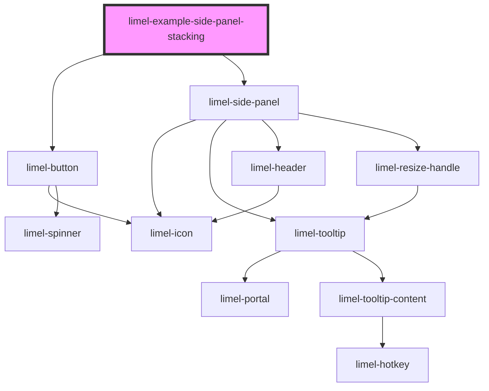

<!-- Auto Generated Below -->

## Overview

Stacking

A panel can open another panel, for example to edit a part of what the first
panel shows. Only one panel is shown at a time. The other panels are shown as
backs behind the left edge of the panel, so the user can go back to them.

Each entry in `stack` is one panel, outermost first. The last entry is the
panel that is shown, and the other entries are the backs. To open a panel,
add an entry at the end of `stack`, and change the content. A back is too
narrow for text, so it only shows the `color` of its entry. Point at a back
to see its heading and subheading in a tooltip.

Click a back to go back to it. The panel emits `selectStackEntry` with the
index of the entry in `stack`. To go back to that panel, remove all entries
after it, and change the content. The example does this.

In this example, `close` goes back one step. Another application could close
all panels instead.

## Dependencies

### Depends on

- [limel-button](../../button)
- [limel-side-panel](..)

### Graph

----------------------------------------------

*Built with [StencilJS](https://stenciljs.com/)*
