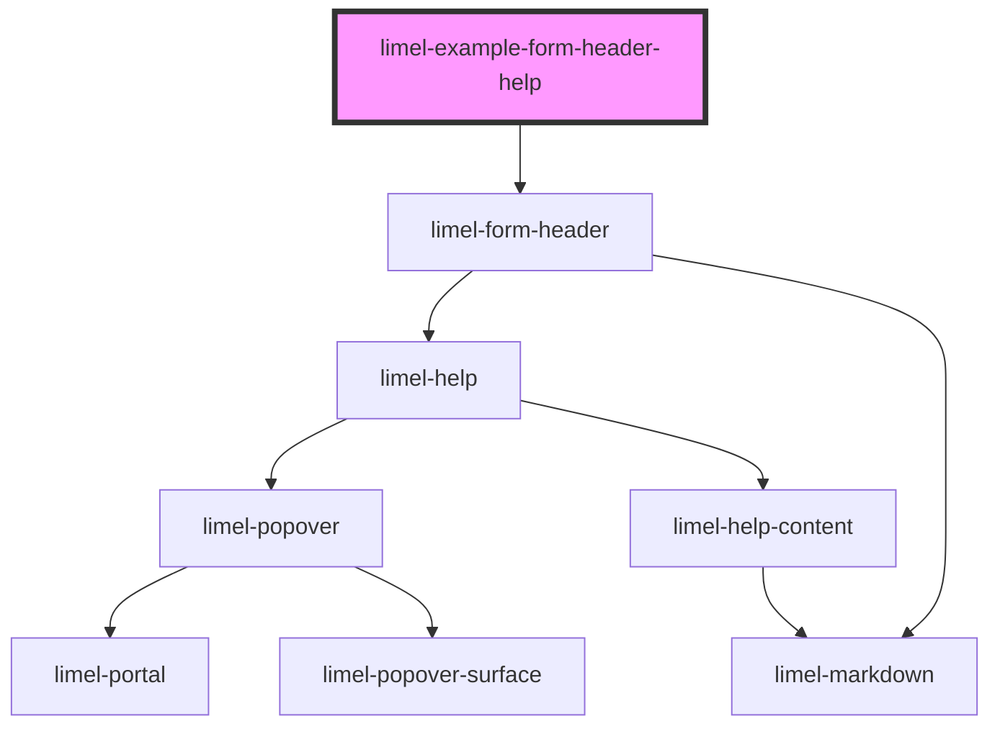

<!-- Auto Generated Below -->

## Overview

Help
A string is used as the `value` of the help. To change anything else of
the help, such as the "Read more" link, give an object with the properties
of [limel-help](#/component/limel-help/).

:::note
**Why the form places the help, and this component does not**

Inside `limel-form`, the help is put in the top left corner of its field,
half a gap above and to the left of it. This component does not do that
itself, so outside a form the help sits under the heading, as in these
examples. This is on purpose:

1. The form also places the help of fields that this component does not
   draw. That rule has to stay in the form, and a second one here would put
   the same thing in two places.
2. The distance comes from the gap variables of the form (`--form-row-gap`
   and `--form-column-gap`). This component does not have them.
3. A title that the form draws above a custom component
   ([#4449](https://github.com/Lundalogik/lime-elements/issues/4449)) is
   also inside a field, so the rule of the form already reaches it.
:::

## Dependencies

### Depends on

- [limel-form-header](..)

### Graph

----------------------------------------------

*Built with [StencilJS](https://stenciljs.com/)*
