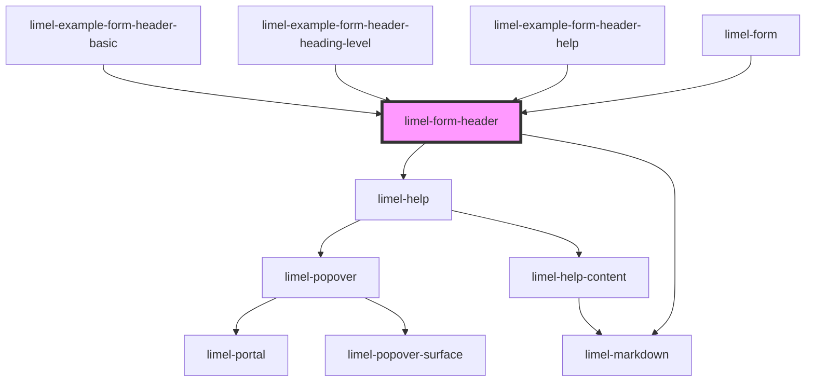

<!-- Auto Generated Below -->

## Overview

This is an internal and private component that `limel-form` uses to
draw the heading of a section, a list or a custom component, together
with its description and its help.

Consumers of `limel-form` do not use it. They set the `title`,
the `description` and `lime.help` in the schema, and the form draws
this component with the right heading level.

:::note
The component has `shadow: false`, so that the heading, the description
and the help are part of the DOM of `limel-form`. This way, the styles
of the form that depend on how deep a field is reach them directly.
:::

## Properties

| Property       | Attribute       | Description                                                                     | Type                         | Default     |
| -------------- | --------------- | ------------------------------------------------------------------------------- | ---------------------------- | ----------- |
| `description`  | `description`   | Text, in markdown, that describes what the `heading` is about.                  | `string`                     | `undefined` |
| `heading`      | `heading`       | The title of the section, the list or the custom component.                     | `string`                     | `undefined` |
| `headingLevel` | `heading-level` | Which of the heading elements, from `h1` to `h6`, to draw the `heading` with.   | `1 \| 2 \| 3 \| 4 \| 5 \| 6` | `1`         |
| `help`         | `help`          | Help to show beside the `heading`. A string is used as the `value` of the help. | `Help \| string`             | `undefined` |

## Dependencies

### Used by

 - [limel-example-form-header-basic](examples)
 - [limel-example-form-header-heading-level](examples)
 - [limel-example-form-header-help](examples)
 - [limel-form](../form)

### Depends on

- [limel-help](../help)
- [limel-markdown](../markdown)

### Graph

----------------------------------------------

*Built with [StencilJS](https://stenciljs.com/)*
