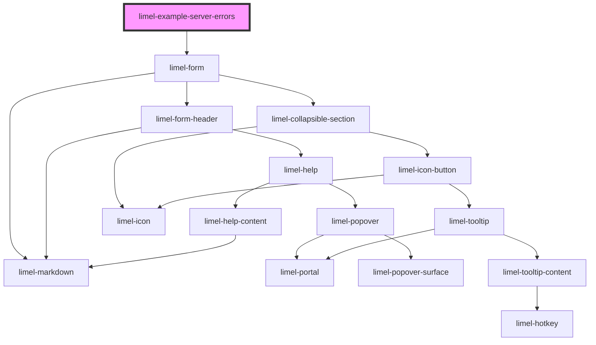

<!-- Auto Generated Below -->

## Overview

Form with server validation

## Dependencies

### Depends on

- [limel-form](..)

### Graph

----------------------------------------------

*Built with [StencilJS](https://stenciljs.com/)*
