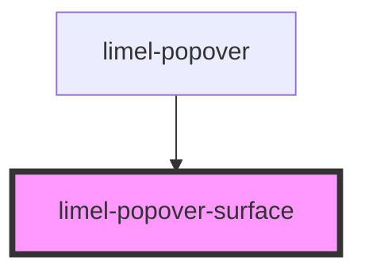

<!-- Auto Generated Below -->

## Properties

| Property            | Attribute          | Description                                       | Type             | Default     |
| ------------------- | ------------------ | ------------------------------------------------- | ---------------- | ----------- |
| `accessibleLabel`   | `accessible-label` | The name of the surface, for assistive technology | `string`         | `undefined` |
| `contentCollection` | --                 | Content to render                                 | `HTMLCollection` | `undefined` |
| `popupRole`         | `popup-role`       | The role of the surface, for assistive technology | `string`         | `undefined` |

## Slots

| Slot | Description                       |
| ---- | --------------------------------- |
|      | Content to put inside the surface |

## Dependencies

### Used by

 - [limel-popover](../popover)

### Graph

----------------------------------------------

*Built with [StencilJS](https://stenciljs.com/)*
