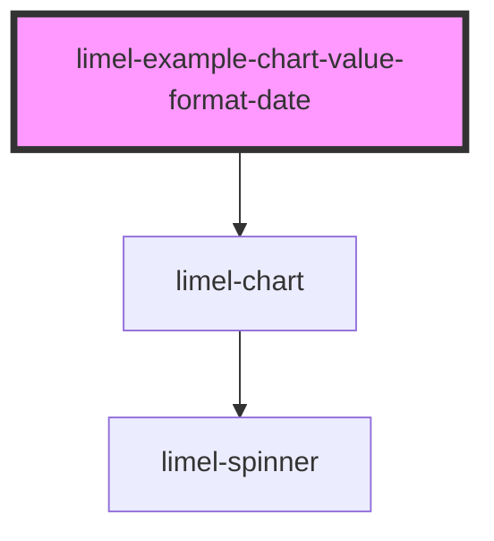

<!-- Auto Generated Below -->

## Overview

Dates
With `valueFormat` set to `date`, each value is a date in milliseconds
since 1970, as `Date.getTime()` gives it. The value axis then marks days,
Mondays, or the first days of months, quarters or years, depending on how
long a time the chart spans, and the tooltips write each date in the
chart's `language`.

Together with ranges, this makes a Gantt chart of real dates.
The axis starts at the earliest date, not at zero.

:::note
`axisIncrement` has no effect on dates, since months and years are not
all equally long.
:::

## Dependencies

### Depends on

- [limel-chart](..)

### Graph

----------------------------------------------

*Built with [StencilJS](https://stenciljs.com/)*
