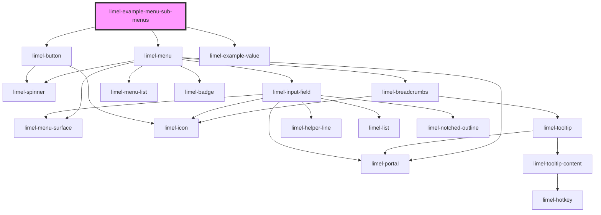

<!-- Auto Generated Below -->

## Overview

Sub-menus
To have an enhanced navigation and provide a better organization of items,
you can incorporate sub-menus within the menu structure;
and create a so called "Cascading menu".
These sub-menus provide the user with an efficient way to access a
wide range of choices without overwhelming them with clutter or complexity.

The main menu, often called the parent menu,
typically consists of top-level options that represent primary categories or options.
Sub-menus, on the other hand, are secondary or menus that are nested
beneath these primary options.

Some of the benefits of creating tree-structure for the menus are:
- **Organized Information:** Sub-menus enable a clear and organized presentation of content,
making it easier for the user to find what they're looking for within a specific category.
- **Space Efficiency:** They save screen space by concealing secondary options until needed,
reducing visual clutter and making the interface cleaner and more user-friendly.
- **Scalability:** Sub-menus can accommodate a large number of choices or features
within a single parent menu, making them suitable for complex applications or websites.
- **Logical Hierarchy:** By structuring information hierarchically,
sub-menus help the user understand the relationships between various
options and navigate through the interface more intuitively.

Our cascading menus are designed to be mobile-friendly.
This means that sub-menus are opened within the same menu surface,
instead of the classic way of sticking out on the side, as a secondary menu.
Thanks to a breadcrumbs component on the top, the user can easily navigate back
and forth within the menu structure.

:::tip
It is also very easy to navigate the nested menu structure using the keyboard.

- Using the <kbd>↓</kbd> & <kbd>↑</kbd> keys, the user can naturally
navigate within the presented menu,
- pressing the <kbd>→</kbd> key on a menu item that has sub-menu opens a nested menu,
- and pressing the <kbd>←</kbd> key takes the user back to the previous/parent menu.
:::

## Dependencies

### Depends on

- [limel-menu](..)
- [limel-button](../../button)
- [limel-example-value](../../../examples)

### Graph

----------------------------------------------

*Built with [StencilJS](https://stenciljs.com/)*
