<!-- Auto Generated Below -->

## Overview

A tooltip can be used to display a descriptive text for any element.
The displayed content must be a brief and supplemental string of text,
identifying the element or describing its function for the user,
helping them better understand unfamiliar objects that aren't described
directly in the UI.

## Interaction
The tooltip appears after a slight delay, when the element is hovered;
and disappears as soon as the cursor leaves the element.
Therefore, users cannot interact with the tip, but if the trigger element
itself is interactive, it will remain interactible even with a tooltip bound
to it.

## Usage
- Keep in mind that tooltips can be distracting, and can be perceived as an interruption.
Use them only when they add significant value.
- A good tip is concise, helpful, and informative.
Don't explain the obvious or simply repeat what is already on the screen.
When used correctly, supplemental info of a tooltip helps to [declutter the UI](#/DesignGuidelines/decluttering.md/).
- If the tip is essential to the primary tasks that the user is performing,
such as warnings or important notes, include the information directly in the
interface instead.
- When a component offers a helper text (e.g. [Input field](#/component/limel-input-field/)),
use that, not a tooltip.
- Make sure to use the tooltip on an element that users naturally and
effortlessly recognize can be hovered.

## Properties

| Property                 | Attribute        | Description                                                                                                                                                                                                                                                                       | Type                                                                                                                                                                 | Default     |
| ------------------------ | ---------------- | --------------------------------------------------------------------------------------------------------------------------------------------------------------------------------------------------------------------------------------------------------------------------------- | -------------------------------------------------------------------------------------------------------------------------------------------------------------------- | ----------- |
| `elementId` _(required)_ | `element-id`     | ID of the owner element that the tooltip should describe. Must be a child within the same document fragment as the tooltip element itself.                                                                                                                                        | `string`                                                                                                                                                             | `undefined` |
| `helperLabel`            | `helper-label`   | Additional helper text for the element. Screen readers read it as a part of the description of the element.                                                                                                                                                                       | `string`                                                                                                                                                             | `undefined` |
| `hotkey`                 | `hotkey`         | Keyboard shortcut to visualize inside the tooltip, e.g. `"ctrl+f"`. Screen readers read it, written out in words, as a part of the description of the element. Display-only: the tooltip does not listen for the keystroke. Catching the hotkey is the consumer's responsibility. | `string`                                                                                                                                                             | `undefined` |
| `label` _(required)_     | `label`          | Short descriptive text of the owner element. Screen readers read it as a part of the description of the element, unless it only repeats the name that the element already has.                                                                                                    | `string`                                                                                                                                                             | `undefined` |
| `maxlength`              | `maxlength`      | The maximum amount of characters before rendering 'label' and 'helperLabel' in two rows.                                                                                                                                                                                          | `number`                                                                                                                                                             | `50`        |
| `openDirection`          | `open-direction` | Decides the tooltip's location in relation to its trigger.                                                                                                                                                                                                                        | `"bottom" \| "bottom-end" \| "bottom-start" \| "left" \| "left-end" \| "left-start" \| "right" \| "right-end" \| "right-start" \| "top" \| "top-end" \| "top-start"` | `'top'`     |

## Dependencies

### Used by

 - [limel-action-bar-item](../action-bar/action-bar-item)
 - [limel-breadcrumbs](../breadcrumbs)
 - [limel-button-group](../button-group)
 - [limel-color-picker](../color-picker)
 - [limel-dock-button](../dock/dock-button)
 - [limel-drag-handle](../drag-handle)
 - [limel-example-button-disabled-vs-hidden](../../design-guidelines/disabled-hidden/examples)
 - [limel-example-button-icon](../button/examples)
 - [limel-example-form-invalid-section](../form/examples)
 - [limel-example-table-movable-rows](../table/examples)
 - [limel-example-tooltip-accessibility](examples)
 - [limel-example-tooltip-basic](examples)
 - [limel-example-tooltip-composite](examples)
 - [limel-example-tooltip-declutter](../../design-guidelines/declutter/examples)
 - [limel-example-tooltip-hotkey](examples)
 - [limel-example-tooltip-max-character](examples)
 - [limel-file-viewer](../file-viewer)
 - [limel-icon-button](../icon-button)
 - [limel-navigation-button](../navigation-button)
 - [limel-pagination](../pagination)
 - [limel-profile-picture](../profile-picture)
 - [limel-resize-handle](../resize-handle)
 - [limel-side-panel](../side-panel)
 - [limel-slider](../slider)

### Depends on

- [limel-portal](../portal)
- [limel-tooltip-content](.)

### Graph

```mermaid
graph TD;
  limel-tooltip --> limel-portal
  limel-tooltip --> limel-tooltip-content
  limel-tooltip-content --> limel-hotkey
  limel-action-bar-item --> limel-tooltip
  limel-breadcrumbs --> limel-tooltip
  limel-button-group --> limel-tooltip
  limel-color-picker --> limel-tooltip
  limel-dock-button --> limel-tooltip
  limel-drag-handle --> limel-tooltip
  limel-example-button-disabled-vs-hidden --> limel-tooltip
  limel-example-button-icon --> limel-tooltip
  limel-example-form-invalid-section --> limel-tooltip
  limel-example-table-movable-rows --> limel-tooltip
  limel-example-tooltip-accessibility --> limel-tooltip
  limel-example-tooltip-basic --> limel-tooltip
  limel-example-tooltip-composite --> limel-tooltip
  limel-example-tooltip-declutter --> limel-tooltip
  limel-example-tooltip-hotkey --> limel-tooltip
  limel-example-tooltip-max-character --> limel-tooltip
  limel-file-viewer --> limel-tooltip
  limel-icon-button --> limel-tooltip
  limel-navigation-button --> limel-tooltip
  limel-pagination --> limel-tooltip
  limel-profile-picture --> limel-tooltip
  limel-resize-handle --> limel-tooltip
  limel-side-panel --> limel-tooltip
  limel-slider --> limel-tooltip
  style limel-tooltip fill:#f9f,stroke:#333,stroke-width:4px
```

----------------------------------------------

*Built with [StencilJS](https://stenciljs.com/)*
