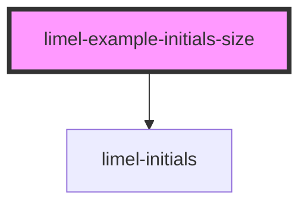

<!-- Auto Generated Below -->

## Overview

Size and shape

By default, the tile is a circle that is `2rem` wide and high. To change
that, set these CSS custom properties on the component, or on any element
around it:
- `--initials-size` sets the width and the height.
- `--initials-border-radius` sets how round the corners are.

Initials are often shown together with pictures, as in this list of
contacts, where only some people have a picture. Give the tiles the same
size and shape as the pictures, and all the names line up in one column.

The letters grow and shrink together with the tile, but never get so small
or so large that they become hard to read.

## Dependencies

### Depends on

- [limel-initials](..)

### Graph

----------------------------------------------

*Built with [StencilJS](https://stenciljs.com/)*
