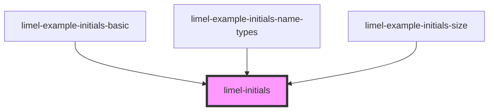

<!-- Auto Generated Below -->

## Overview

Initials are the first letters of a name, shown in a small round tile.
Use them where you would show a picture of a person or the logo of a
company, but there is none. A list of contacts, for example, can show a
profile picture for the people who have one, and initials for everyone
else. That way, every row still starts with something that is quick to
recognize.

Give the component a `name`, and it works out which letters to show.
By default, it takes the first letter of the first, the second and the
last word, so "Maja Lindqvist" becomes "ML". That suits most names,
whether they belong to a person, a pet or a product. Set `nameType` to
read the name of a company instead, or to show letters that you have
already picked yourself. The examples below explain the rules for each
kind of name.

The tile shows at most three letters. When it shows three, the text gets
smaller, so that the letters still fit.

When the name has no letters or digits, for example when it is empty or
only contains an emoji, nothing is rendered. The same goes for the name of
a company that is only a legal form, such as "AB". If you want to show
something else in those cases, such as an icon, call the `getInitials`
function that this library exports. It returns the letters that the tile
would show, or `undefined` when there are none.

:::note
The tile is hidden from assistive technology, such as screen readers.
Initials only repeat a name that should already be written next to them,
and hearing "M L" before "Maja Lindqvist" would not help anyone. For the
same reason, a picture shown next to a name should have an empty `alt`
text.
:::

## Properties

| Property   | Attribute   | Description                                                                                                                                                                                                                                                                   | Type                                   | Default     |
| ---------- | ----------- | ----------------------------------------------------------------------------------------------------------------------------------------------------------------------------------------------------------------------------------------------------------------------------- | -------------------------------------- | ----------- |
| `name`     | `name`      | The name to show the initials of, for example `Maja Lindqvist` or `Northwind Bikes AB`. How the name is read depends on `nameType`.  Nothing is rendered when the name has no letters or digits.                                                                              | `string`                               | `undefined` |
| `nameType` | `name-type` | What kind of name `name` is, which decides how the letters are worked out: - `default`: suits most names, such as those of people, pets or products. - `company`: the name of a company or another organization. - `initials`: letters that you have already picked yourself. | `"company" \| "default" \| "initials"` | `'default'` |

## Dependencies

### Used by

 - [limel-example-initials-basic](examples)
 - [limel-example-initials-name-types](examples)
 - [limel-example-initials-size](examples)

### Graph

----------------------------------------------

*Built with [StencilJS](https://stenciljs.com/)*
