<!-- Auto Generated Below -->

## Properties

| Property      | Attribute     | Description                                                                                                                                                                                                                                                                                                                                                                                                                  | Type                                                                         | Default      |
| ------------- | ------------- | ---------------------------------------------------------------------------------------------------------------------------------------------------------------------------------------------------------------------------------------------------------------------------------------------------------------------------------------------------------------------------------------------------------------------------- | ---------------------------------------------------------------------------- | ------------ |
| `disabled`    | `disabled`    | Set to `true` to disable the field. Use `disabled` to indicate that the field can normally be interacted with, but is currently disabled. This tells the user that if certain requirements are met, the field may become enabled again.                                                                                                                                                                                      | `boolean`                                                                    | `false`      |
| `format`      | `format`      | Format to display the selected date in.                                                                                                                                                                                                                                                                                                                                                                                      | `string`                                                                     | `undefined`  |
| `formatter`   | --            | Custom formatting function. Will be used for date formatting.  :::note overrides `format` and `language`. A date can only be typed into the field when `format` is set as well, to the pattern your `formatter` produces. Typed text is parsed with `format` and `language`, and the field shows the value in `format` while it is being edited. :::                                                                         | `(date: Date) => string`                                                     | `undefined`  |
| `helperText`  | `helper-text` | Optional helper text to display below the input field when it has focus. Screen readers read it as the description of the field, so use it for what the user needs to know, such as the format of the value or a requirement.  While the typed text is not a valid date, a message naming the expected format is shown instead.                                                                                              | `string`                                                                     | `undefined`  |
| `invalid`     | `invalid`     | Set to `true` to indicate that the current value of the date picker is invalid. Typed text that is not a valid date is flagged by the component itself, whatever this is set to.                                                                                                                                                                                                                                             | `boolean`                                                                    | `false`      |
| `label`       | `label`       | Text to display next to the date picker                                                                                                                                                                                                                                                                                                                                                                                      | `string`                                                                     | `undefined`  |
| `language`    | `language`    | Defines the localisation for translations and date formatting. Property `format` customizes the localized date format.                                                                                                                                                                                                                                                                                                       | `"da" \| "de" \| "en" \| "fi" \| "fr" \| "nb" \| "nl" \| "no" \| "sv"`       | `'en'`       |
| `placeholder` | `placeholder` | A hint about what to type, such as an example or the format of the value. It is shown inside the field when the field is focused and empty, but not on iOS and Android, where the native date picker is used.  Do not use it instead of a `label`, and do not put anything in it that the user needs to know. It disappears when the user starts to type, and some screen readers do not read it. Use `helperText` for that. | `string`                                                                     | `undefined`  |
| `readonly`    | `readonly`    | Set to `true` to make the field read-only. Use `readonly` when the field is only there to present the data it holds, and will not become possible for the current user to edit.                                                                                                                                                                                                                                              | `boolean`                                                                    | `false`      |
| `required`    | `required`    | Set to `true` to indicate that the field is required.                                                                                                                                                                                                                                                                                                                                                                        | `boolean`                                                                    | `false`      |
| `type`        | `type`        | Type of date picker.                                                                                                                                                                                                                                                                                                                                                                                                         | `"date" \| "datetime" \| "month" \| "quarter" \| "time" \| "week" \| "year"` | `'datetime'` |
| `value`       | --            | The value of the field.                                                                                                                                                                                                                                                                                                                                                                                                      | `Date`                                                                       | `undefined`  |

## Events

| Event    | Description                                                                                                                                                                                                                              | Type                |
| -------- | ---------------------------------------------------------------------------------------------------------------------------------------------------------------------------------------------------------------------------------------- | ------------------- |
| `change` | Emitted when a typed date is committed (on blur or `Enter`), when a date is picked in the calendar, and with `null` when the field is cleared. Typed text that is not a valid date is not emitted, so `value` keeps the last valid date. | `CustomEvent<Date>` |

## Dependencies

### Used by

 - [limel-example-date-picker-composite](examples)
 - [limel-example-date-picker-custom-formatter](examples)
 - [limel-example-date-picker-date](examples)
 - [limel-example-date-picker-datetime](examples)
 - [limel-example-date-picker-formatted](examples)
 - [limel-example-date-picker-month](examples)
 - [limel-example-date-picker-programmatic-change](examples)
 - [limel-example-date-picker-quarter](examples)
 - [limel-example-date-picker-time](examples)
 - [limel-example-date-picker-typed-input](examples)
 - [limel-example-date-picker-week](examples)
 - [limel-example-date-picker-year](examples)

### Depends on

- [limel-input-field](../input-field)
- [limel-portal](../portal)
- [limel-flatpickr-adapter](flatpickr-adapter)

### Graph

```mermaid
graph TD;
  limel-date-picker --> limel-input-field
  limel-date-picker --> limel-portal
  limel-date-picker --> limel-flatpickr-adapter
  limel-input-field --> limel-helper-line
  limel-input-field --> limel-icon
  limel-input-field --> limel-portal
  limel-input-field --> limel-menu-surface
  limel-input-field --> limel-list
  limel-input-field --> limel-notched-outline
  limel-example-date-picker-composite --> limel-date-picker
  limel-example-date-picker-custom-formatter --> limel-date-picker
  limel-example-date-picker-date --> limel-date-picker
  limel-example-date-picker-datetime --> limel-date-picker
  limel-example-date-picker-formatted --> limel-date-picker
  limel-example-date-picker-month --> limel-date-picker
  limel-example-date-picker-programmatic-change --> limel-date-picker
  limel-example-date-picker-quarter --> limel-date-picker
  limel-example-date-picker-time --> limel-date-picker
  limel-example-date-picker-typed-input --> limel-date-picker
  limel-example-date-picker-week --> limel-date-picker
  limel-example-date-picker-year --> limel-date-picker
  style limel-date-picker fill:#f9f,stroke:#333,stroke-width:4px
```

----------------------------------------------

*Built with [StencilJS](https://stenciljs.com/)*
