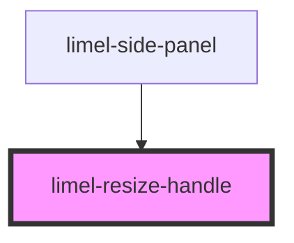

<!-- Auto Generated Below -->

## Overview

A handle on the left edge of an element, which the user drags to resize the
element.

## Properties

| Property | Attribute | Description                                              | Type     | Default     |
| -------- | --------- | -------------------------------------------------------- | -------- | ----------- |
| `label`  | `label`   | The accessible name of the handle.                       | `string` | `undefined` |
| `max`    | `max`     | The largest width that the element can have, in pixels.  | `number` | `undefined` |
| `min`    | `min`     | The smallest width that the element can have, in pixels. | `number` | `undefined` |
| `value`  | `value`   | The width of the element, in pixels.                     | `number` | `undefined` |

## Events

| Event        | Description                                                                                                                                                                                          | Type                  |
| ------------ | ---------------------------------------------------------------------------------------------------------------------------------------------------------------------------------------------------- | --------------------- |
| `changeSize` | Emitted on each pointer move during a drag, and on each arrow key press. The detail is the width that the user asks for, in pixels. The consumer limits it, uses it, and sets the result as `value`. | `CustomEvent<number>` |
| `endResize`  | Emitted when the user has finished a resize: when the pointer is released, and after `changeSize` for each arrow key press.                                                                          | `CustomEvent<void>`   |

## Dependencies

### Used by

 - [limel-side-panel](../side-panel)

### Graph

----------------------------------------------

*Built with [StencilJS](https://stenciljs.com/)*
