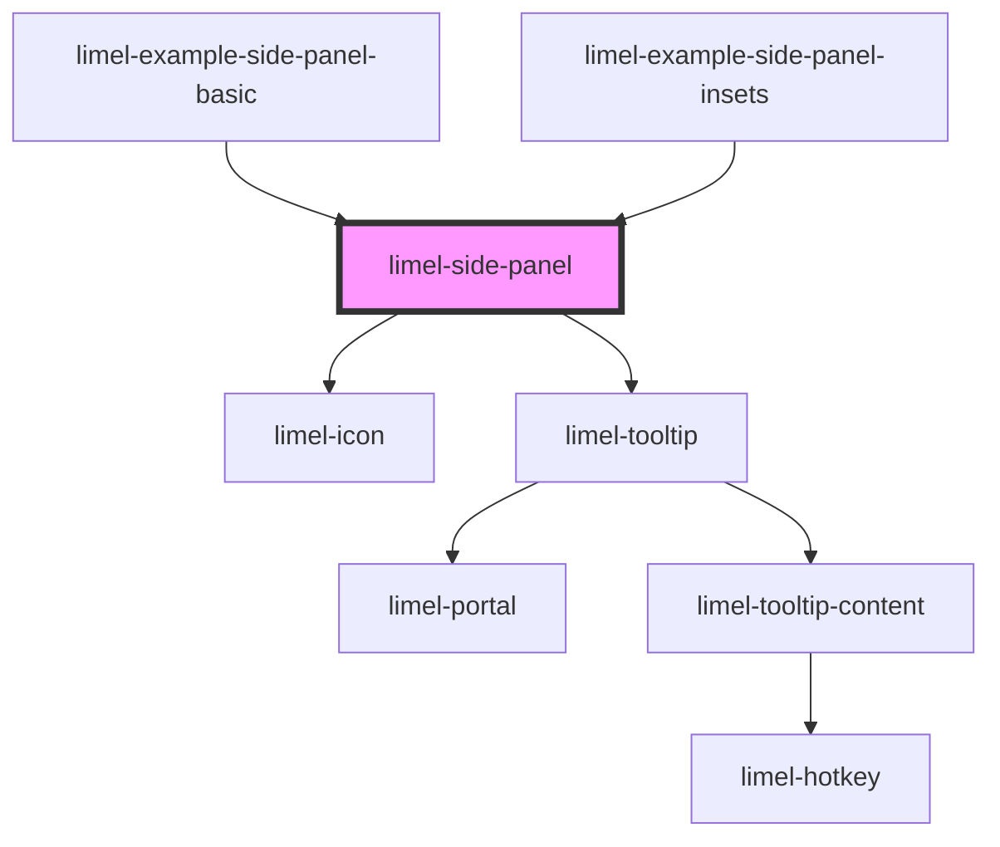

<!-- Auto Generated Below -->

## Overview

A resizable panel that is displayed on top of the right side of the page.
The content is placed in the default slot, below a toolbar with a close button.

The panel is positioned relative to its nearest positioned ancestor. Set
`position: relative` on that element. Use `--side-panel-top-inset`,
`--side-panel-right-inset` and `--side-panel-bottom-inset` to keep parts of
that element visible, for example a header.

The CSS custom properties can be set on the panel or on any ancestor.

## Closing

The `close` event is emitted when the user clicks the close button, or presses
Escape anywhere on the page. The panel does not remove itself. The consumer
must remove it from the DOM.

An Escape keydown event with `defaultPrevented` set does not emit `close`.
This lets a popover or dropdown inside the panel handle Escape without
closing the panel. `limel-dialog` does not prevent the event yet, so Escape in
a dialog inside the panel also closes the panel. The panel listens on `window`, so it receives the
event after all listeners on elements and on `document`.

When more than one side panel is open, Escape closes only the panel that was
opened last.

`close` and `changeWidth` events from the slotted content do not propagate
past the panel. This prevents a consumer from mistaking them for events
emitted by the panel.

## Width

The user can resize the panel by dragging its left edge. The panel then emits
`changeWidth` with the new width in pixels. The panel does not keep the width.
To keep it, for example across sessions, store the value and set it with
`--side-panel-width`.

The user can also resize the panel with the keyboard. When the handle has
focus, ArrowLeft makes the panel wider and ArrowRight makes it narrower.

The emitted width is clamped to the width the panel can actually have, as
limited by `--side-panel-min-width` and the available space.

To use a default width until the user has resized the panel, set a fallback:
`--side-panel-width: var(--stored-width, 30rem)`.

## Properties

| Property      | Attribute      | Description                                                                    | Type     | Default    |
| ------------- | -------------- | ------------------------------------------------------------------------------ | -------- | ---------- |
| `closeLabel`  | `close-label`  | Label of the close button. Shown as a tooltip and used as the accessible name. | `string` | `'Close'`  |
| `resizeLabel` | `resize-label` | Label of the resize handle. Used as the accessible name.                       | `string` | `'Resize'` |

## Events

| Event         | Description                                                                           | Type                  |
| ------------- | ------------------------------------------------------------------------------------- | --------------------- |
| `changeWidth` | Emitted when the panel is resized by the user. The detail is the new width in pixels. | `CustomEvent<number>` |
| `close`       | Emitted when the close button is clicked, or when Escape is pressed.                  | `CustomEvent<void>`   |

## Dependencies

### Used by

 - [limel-example-side-panel-basic](examples)
 - [limel-example-side-panel-insets](examples)

### Depends on

- [limel-icon](../icon)
- [limel-tooltip](../tooltip)

### Graph

----------------------------------------------

*Built with [StencilJS](https://stenciljs.com/)*
