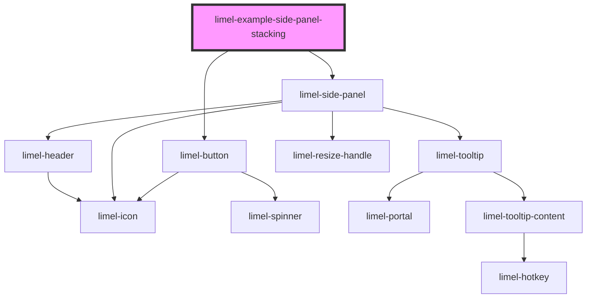

<!-- Auto Generated Below -->

## Overview

Stacking

Open a panel from inside the panel to make a stack. The last entry of
`stack` is the panel that is shown. The other entries are shown as backs
behind its left edge. Point at a back to see its heading.

Click a back to go back to it. The panel emits `selectStackEntry` with the
index of the entry in `stack`, and the example removes all entries after it.

In this example, `close` goes back one step. Another application could close
all panels instead.

## Dependencies

### Depends on

- [limel-button](../../button)
- [limel-side-panel](..)

### Graph

----------------------------------------------

*Built with [StencilJS](https://stenciljs.com/)*
