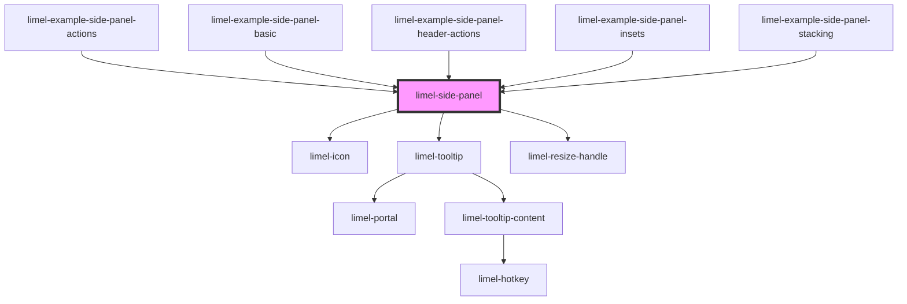

<!-- Auto Generated Below -->


## Overview

A resizable panel that is displayed on top of the right side of the page.
The content is placed in the default slot, below a toolbar and a header.

The panel is positioned relative to its nearest positioned ancestor. Set
`position: relative` on that element. Use `--side-panel-top-inset`,
`--side-panel-right-inset` and `--side-panel-bottom-inset` to keep parts of
that element visible, for example a header.

The CSS custom properties can be set on the panel or on any ancestor.

## Header

The header shows the heading, subheading and icon of the last entry in
`stack`. When the entry has a `color`, the header gets that background color,
and the headings are white with a text shadow. When `stack` is empty, the
panel has no header.

Put controls for the header, for example a follow button or a menu, in the
`header-actions` slot. They are shown at the right end of the header. When
`stack` is empty, there is no header, and the slot content is not shown.

The slot is for small controls. It is at most half as wide as the header,
and at most as tall as the heading and subheading together. Larger content
is cut off, so that the header keeps its size.

The slot content is not tied to an entry in `stack`. When the last entry
changes, the consumer must also change the slot content.

The slot content keeps its own colors. Use `--side-panel-header-text-color`
to match the text color of the header. It is white when the header has a
`color`. It can also be used as the `color` of an `Icon`.

## Stack

A panel can open another panel, for example to edit a part of what the first
panel shows. Only one panel is shown at a time. The other panels are shown as
backs behind the left edge of the panel, so the user can go back to them.

Each entry in `stack` is one panel, outermost first. The last entry is the
panel that is shown, and the other entries are the backs. To open a panel,
add an entry at the end of `stack`, and change the content. A back is too
narrow for text, so it only shows the `color` of its entry. Its heading and
subheading are shown in a tooltip.

When the user clicks a back, the panel emits `selectStackEntry` with the
index of its entry in `stack`. To go back to that panel, remove all entries
after it, and change the content.

## Actions

The toolbar has a close button on the left. Other buttons are set with
`actions`, and are shown on the right. The `type` of an action decides its
icon. When the user clicks an action, the panel emits `selectAction` with the
`id` of the action and the click event. The consumer decides what the action
does.

An action with an `href` is a link, so the user can open it in a new tab.
To handle the navigation in another way, for example with the router of the
application, call `preventDefault` on the click event in `selectAction`. Do
this only for a plain click with the primary button. Let the browser handle
all other clicks, so that Ctrl-click and Cmd-click still open the link in a
new tab:

```ts
function handleSelectAction(event: CustomEvent<SidePanelActionSelect>) {
    const click = event.detail.event;
    const isPlainClick =
        click.button === 0 &&
        !click.metaKey &&
        !click.ctrlKey &&
        !click.shiftKey &&
        !click.altKey;
    if (!isPlainClick) {
        return;
    }

    click.preventDefault();
    router.navigate(event.detail.id);
}
```

## Closing

The `close` event is emitted when the user clicks the close button, or presses
Escape anywhere on the page. The panel does not remove itself. The consumer
must remove it from the DOM.

An Escape keydown event with `defaultPrevented` set does not emit `close`.
This lets a popover or dropdown inside the panel handle Escape without
closing the panel. `limel-dialog` does not prevent the event yet, so Escape in
a dialog inside the panel also closes the panel. The panel listens on `window`, so it receives the
event after all listeners on elements and on `document`.

When more than one side panel is open, Escape closes only the panel that was
opened last.

`close` and `changeWidth` events from the slotted content do not propagate
past the panel. This prevents a consumer from mistaking them for events
emitted by the panel.

## Full screen

On a small screen, there is no space for the panel next to the page. Set
`fullScreen` to let the panel cover the full width of the positioned
ancestor. The top and bottom insets are kept. The panel then cannot be
resized, and the backs of the stack are not shown. The header still shows
the last entry of `stack`.

## Width

The panel starts with the width from `--side-panel-width`. The user can
resize the panel by dragging its left edge. The user can also use the
keyboard. When the handle has focus, ArrowLeft makes the panel wider and
ArrowRight makes it narrower.

The panel keeps the new width itself. While the panel exists, this width wins
over `--side-panel-width`. The width is limited by `--side-panel-min-width`
and the available space.

After each resize, the panel emits `changeWidth` with the new width in
pixels. The consumer does not have to handle the event. To keep the width
for the next time the panel opens, for example across sessions, store the
value. Then set it with `--side-panel-width` before the panel opens.

## Properties

| Property      | Attribute      | Description                                                                                                                                                                                                                    | Type                | Default    |
| ------------- | -------------- | ------------------------------------------------------------------------------------------------------------------------------------------------------------------------------------------------------------------------------ | ------------------- | ---------- |
| `actions`     | --             | Buttons in the toolbar, to the right of the close button.                                                                                                                                                                      | `SidePanelAction[]` | `[]`       |
| `closeLabel`  | `close-label`  | Label of the close button. Shown as a tooltip and used as the accessible name.                                                                                                                                                 | `string`            | `'Close'`  |
| `fullScreen`  | `full-screen`  | Set to `true` when the screen is too narrow for the panel to be displayed on top of the page. The panel then covers the full width of the positioned ancestor. It cannot be resized, and the backs of the stack are not shown. | `boolean`           | `false`    |
| `resizeLabel` | `resize-label` | Label of the resize handle. Used as the accessible name.                                                                                                                                                                       | `string`            | `'Resize'` |
| `stack`       | --             | The panels in the stack, outermost first. The last entry is the panel that is displayed. Its heading, subheading and icon are shown in the header. The other entries are shown as backs behind the panel.                      | `SidePanelEntry[]`  | `[]`       |


## Events

| Event              | Description                                                                                                                                                                                                             | Type                                 |
| ------------------ | ----------------------------------------------------------------------------------------------------------------------------------------------------------------------------------------------------------------------- | ------------------------------------ |
| `changeWidth`      | Emitted when the user has resized the panel. The detail is the new width in pixels. The panel already uses the new width. Store the value to restore the width with `--side-panel-width` the next time the panel opens. | `CustomEvent<number>`                |
| `close`            | Emitted when the close button is clicked, or when Escape is pressed.                                                                                                                                                    | `CustomEvent<void>`                  |
| `selectAction`     | Emitted when an action in the toolbar is clicked. The detail has the `id` of the action, or its `type` if it has no `id`, and the click event.                                                                          | `CustomEvent<SidePanelActionSelect>` |
| `selectStackEntry` | Emitted when a back of the stack is clicked. The detail is the index of its entry in `stack`.                                                                                                                           | `CustomEvent<number>`                |


## Slots

| Slot               | Description                                                                                                                                |
| ------------------ | ------------------------------------------------------------------------------------------------------------------------------------------ |
|                    | Content of the panel                                                                                                                       |
| `"header-actions"` | Small controls at the right end of the header. Content that is larger than half the header width or the height of the headings is cut off. |


## Dependencies

### Used by

 - [limel-example-side-panel-actions](examples)
 - [limel-example-side-panel-basic](examples)
 - [limel-example-side-panel-header-actions](examples)
 - [limel-example-side-panel-insets](examples)
 - [limel-example-side-panel-stacking](examples)

### Depends on

- [limel-icon](../icon)
- [limel-tooltip](../tooltip)
- [limel-resize-handle](../resize-handle)

### Graph


----------------------------------------------

*Built with [StencilJS](https://stenciljs.com/)*
