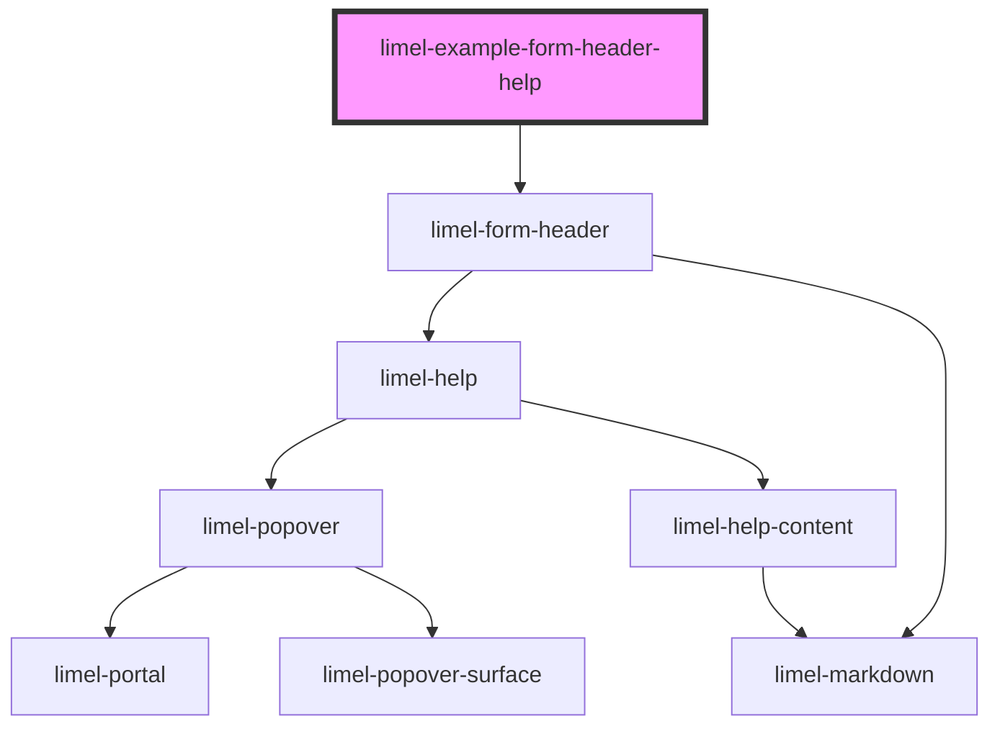

<!-- Auto Generated Below -->

## Overview

Help
A string is used as the `value` of the help. To change anything else of
the help, such as the "Read more" link, give an object with the properties
of [limel-help](#/component/limel-help/).

## Dependencies

### Depends on

- [limel-form-header](..)

### Graph

----------------------------------------------

*Built with [StencilJS](https://stenciljs.com/)*
