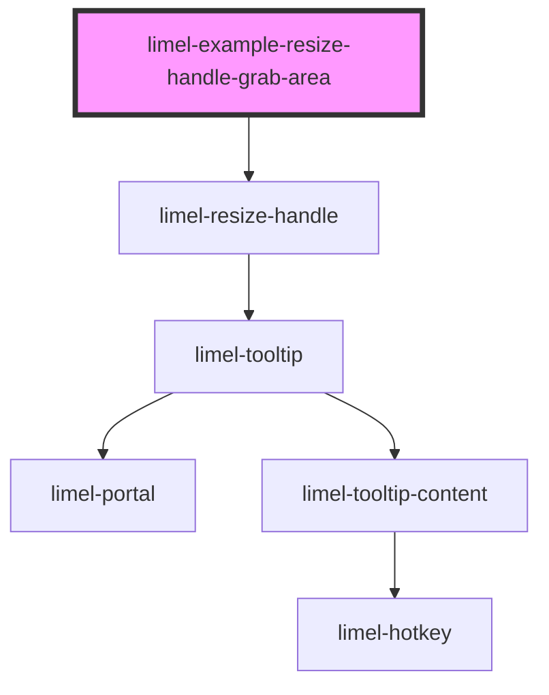

<!-- Auto Generated Below -->

## Overview

Larger grab area

A handle at the top or the bottom can have a larger grab area, which is
easier to hit with a finger. Set the size of the grab area with
`--limel-resize-handle-thickness`, and the length of the visible strip with
`--limel-resize-handle-visual-length`. The grab area grows away from the
edge, and the visible strip stays at the edge.

The background of the handle in this example shows the grab area.

## Dependencies

### Depends on

- [limel-resize-handle](..)

### Graph

----------------------------------------------

*Built with [StencilJS](https://stenciljs.com/)*
