<!-- Auto Generated Below -->

## Properties

| Property           | Attribute       | Description                                                                                                                                                                                                                                                                                                                                                                                                                             | Type                                               | Default     |
| ------------------ | --------------- | --------------------------------------------------------------------------------------------------------------------------------------------------------------------------------------------------------------------------------------------------------------------------------------------------------------------------------------------------------------------------------------------------------------------------------------- | -------------------------------------------------- | ----------- |
| `disabled`         | `disabled`      | Set to `true` to disable the whole form.                                                                                                                                                                                                                                                                                                                                                                                                | `boolean`                                          | `false`     |
| `errors`           | --              | Extra errors to display in the form. Typical use case is asynchronous errors generated server side.                                                                                                                                                                                                                                                                                                                                     | `{ [key: string]: string[] \| ValidationError; }`  | `undefined` |
| `fillDefaults`     | `fill-defaults` | Set to `false` to leave the defaults of the schema out of the value it is given. The form then does not change the value by itself, and a field with a default shows what the value holds, which can be nothing. Defaults that a change by the user brings in are still filled in, such as those of a new list item or of fields that depend on the changed one.                                                                        | `boolean`                                          | `true`      |
| `headingLevel`     | `heading-level` | The level, from `1` to `6`, of the topmost headings in the form. The headings of the sections inside them get one level more for each level of nesting, down to `6`. A collapsible section, and each item of a list that is shown as one, counts as a level too.  Set it so that the headings of the form fit below the headings of the page around it. For example, when the form is in a section with an `h2` heading, set it to `3`. | `1 \| 2 \| 3 \| 4 \| 5 \| 6`                       | `1`         |
| `highlightedField` | --              | The path in the value of a field to take the user to, such as `['heroes', 2, 'name']`. When it changes, the form opens the sections and list items the field is in, scrolls it into view, focuses it and briefly highlights it.  If the path goes further than the form can show, such as into a custom component, the closest field above the end of the path is shown. To show the same field again, set it to `undefined` first.     | `(string \| number)[]`                             | `undefined` |
| `propsFactory`     | --              | Factory for creating properties for custom form components  When using custom components in the form some properties might have to be set dynamically. If this factory is set, it will be called with the current schema for the field for each custom component in the form. The factory must return an object where each key is the name of the property that should be set, along with its value.                                    | `(schema: FormSchema<any>) => Record<string, any>` | `undefined` |
| `revealErrors`     | `reveal-errors` | Set to `true` to render every field with a validation error as invalid, even untouched ones, and to reflect that on each containing collapsible section's header. Defaults to `false`, which keeps untouched required-empty fields silent.                                                                                                                                                                                              | `boolean`                                          | `false`     |
| `schema`           | --              | The schema used to render the form                                                                                                                                                                                                                                                                                                                                                                                                      | `FormSchema<any>`                                  | `{}`        |
| `transformErrors`  | --              | Custom function to customize the default error messages                                                                                                                                                                                                                                                                                                                                                                                 | `(errors: FormError[]) => FormError[]`             | `undefined` |
| `value`            | --              | Value of the form                                                                                                                                                                                                                                                                                                                                                                                                                       | `object`                                           | `undefined` |

## Events

| Event      | Description                                                                                | Type                            |
| ---------- | ------------------------------------------------------------------------------------------ | ------------------------------- |
| `change`   | Emitted when a change is made within the form                                              | `CustomEvent<object>`           |
| `validate` | Emitted when the validity of the form changes, or when a change is made to an invalid form | `CustomEvent<ValidationStatus>` |

## Dependencies

### Used by

 - [limel-example-builtin-field-types-form](examples)
 - [limel-example-button-group-composite](../button-group/examples)
 - [limel-example-callout-composite](../callout/examples)
 - [limel-example-chip-set-composite](../chip-set/examples)
 - [limel-example-code-editor-form](examples)
 - [limel-example-custom-component-form](examples)
 - [limel-example-custom-error-message](examples)
 - [limel-example-date-picker-composite](../date-picker/examples)
 - [limel-example-dialog-form](../dialog/examples)
 - [limel-example-dynamic-form](examples)
 - [limel-example-file-composite](../file/examples)
 - [limel-example-form](examples)
 - [limel-example-form-array-item-controls](examples)
 - [limel-example-form-fill-defaults](examples)
 - [limel-example-form-heading-level](examples)
 - [limel-example-form-highlighted-field](examples)
 - [limel-example-form-invalid-section](examples)
 - [limel-example-form-layout](examples)
 - [limel-example-form-row-layout](examples)
 - [limel-example-form-span-fields](examples)
 - [limel-example-form-with-help](examples)
 - [limel-example-list-form](examples)
 - [limel-example-menu-composite](../menu/examples)
 - [limel-example-nested-form](examples)
 - [limel-example-picker-composite](../picker/examples)
 - [limel-example-props-factory-form](examples)
 - [limel-example-server-errors](examples)
 - [limel-example-slider-composite](../slider/examples)
 - [limel-example-text-editor-as-form-component](../text-editor/examples)
 - [limel-example-tooltip-composite](../tooltip/examples)

### Depends on

- [limel-markdown](../markdown)
- [limel-form-header](../form-header)
- [limel-collapsible-section](../collapsible-section)

### Graph

```mermaid
graph TD;
  limel-form --> limel-markdown
  limel-form --> limel-form-header
  limel-form --> limel-collapsible-section
  limel-form-header --> limel-help
  limel-form-header --> limel-markdown
  limel-help --> limel-popover
  limel-help --> limel-help-content
  limel-popover --> limel-portal
  limel-popover --> limel-popover-surface
  limel-help-content --> limel-markdown
  limel-collapsible-section --> limel-icon
  limel-collapsible-section --> limel-icon-button
  limel-icon-button --> limel-icon
  limel-icon-button --> limel-tooltip
  limel-tooltip --> limel-portal
  limel-tooltip --> limel-tooltip-content
  limel-tooltip-content --> limel-hotkey
  limel-example-builtin-field-types-form --> limel-form
  limel-example-button-group-composite --> limel-form
  limel-example-callout-composite --> limel-form
  limel-example-chip-set-composite --> limel-form
  limel-example-code-editor-form --> limel-form
  limel-example-custom-component-form --> limel-form
  limel-example-custom-error-message --> limel-form
  limel-example-date-picker-composite --> limel-form
  limel-example-dialog-form --> limel-form
  limel-example-dynamic-form --> limel-form
  limel-example-file-composite --> limel-form
  limel-example-form --> limel-form
  limel-example-form-array-item-controls --> limel-form
  limel-example-form-fill-defaults --> limel-form
  limel-example-form-heading-level --> limel-form
  limel-example-form-highlighted-field --> limel-form
  limel-example-form-invalid-section --> limel-form
  limel-example-form-layout --> limel-form
  limel-example-form-row-layout --> limel-form
  limel-example-form-span-fields --> limel-form
  limel-example-form-with-help --> limel-form
  limel-example-list-form --> limel-form
  limel-example-menu-composite --> limel-form
  limel-example-nested-form --> limel-form
  limel-example-picker-composite --> limel-form
  limel-example-props-factory-form --> limel-form
  limel-example-server-errors --> limel-form
  limel-example-slider-composite --> limel-form
  limel-example-text-editor-as-form-component --> limel-form
  limel-example-tooltip-composite --> limel-form
  style limel-form fill:#f9f,stroke:#333,stroke-width:4px
```

----------------------------------------------

*Built with [StencilJS](https://stenciljs.com/)*
