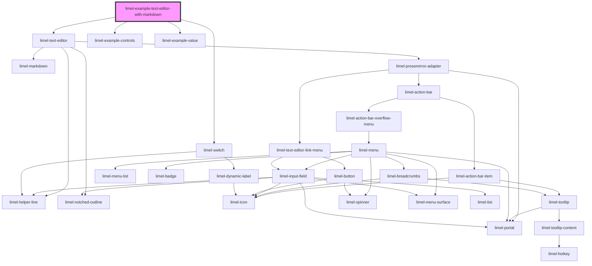

<!-- Auto Generated Below -->

## Overview

Text editor in markdown mode.

When using the text editor in markdown mode the `value` property is expected to contain
a markdown formatted string and the output will likewise be markdown. This is the default
if no value for `contentType` is provided.

## Dependencies

### Depends on

- [limel-text-editor](..)
- [limel-example-controls](../../../examples)
- [limel-switch](../../switch)
- [limel-example-value](../../../examples)

### Graph

----------------------------------------------

*Built with [StencilJS](https://stenciljs.com/)*
