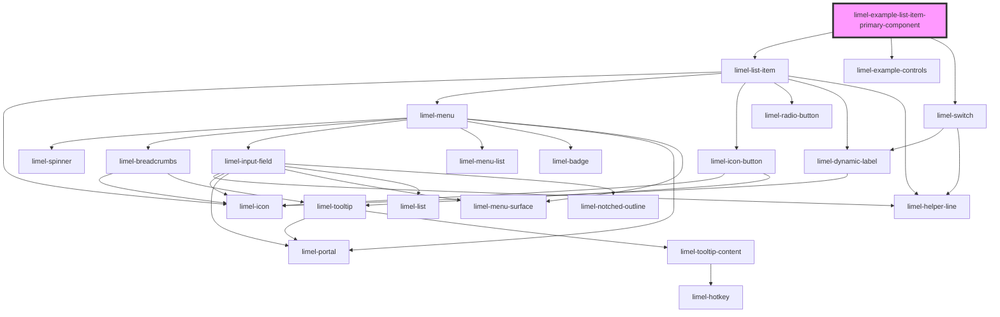

<!-- Auto Generated Below -->

## Overview

Primary component in a list item

This example shows how to render a custom primary component inside
`limel-list-item` using the `primaryComponent` prop.

:::note
By default, the primary component is rendered after the icon,
and before the item's text.

Since the list item is a flex box, you can easily change the
order of the primary component by applying a different `order` as
a style. This could be done either via the primary component's own
styles, or via its `props` in the list.
:::

:::note
The primary component does not become automatically disabled,
once the list item is disabled. Clicks on, or interactions with the component
will still be registered on disabled items.
The consumer should handle the disabled state of their components accordingly.
:::

## Dependencies

### Depends on

- [limel-list-item](..)
- [limel-example-controls](../../../examples)
- [limel-switch](../../switch)

### Graph

----------------------------------------------

*Built with [StencilJS](https://stenciljs.com/)*
