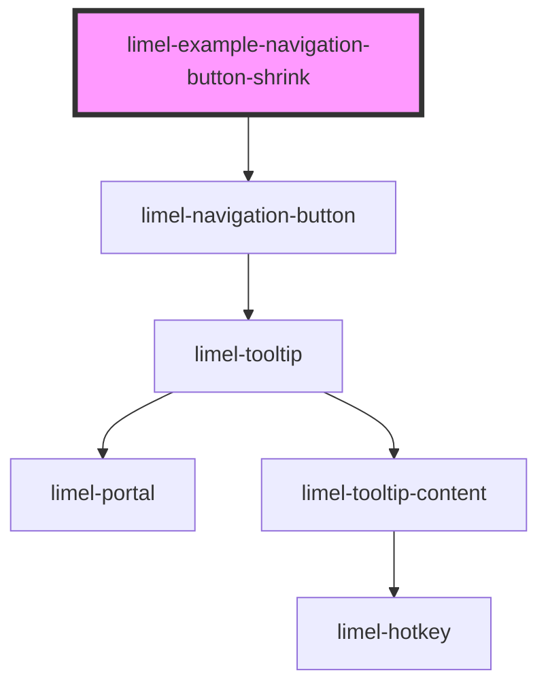

<!-- Auto Generated Below -->

## Overview

`type="shrink"`
Indicates that "the thing the button belongs to" can be shown in a smaller view.
Can be used to indicate that fullscreen mode can be exited, that a "main"
view can be made into a side-view, or that a larger side-view can be made into
a smaller side-view.

## Dependencies

### Depends on

- [limel-navigation-button](..)

### Graph

----------------------------------------------

*Built with [StencilJS](https://stenciljs.com/)*
