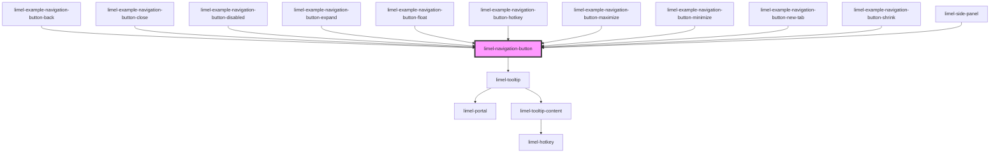

<!-- Auto Generated Below -->

## Overview

A button for the navigation actions that most applications share, such as
closing a dialog, going back, showing a view in fullscreen, or opening
content in a panel on the side.

These actions should look and feel the same everywhere in an application,
so that users recognize the buttons quickly and know what to expect when
they click them.

## Button or link

The same navigation action can be two different things, depending on the
application. "Close" may hide a dialog on the current page, or it may take
the user to another page. Both should look the same, but they are not the
same thing to a browser or to a screen reader. That is why the component
can render as either, and the `href` property decides which:

- **Without `href`, it is a `<button>`.** Use this when the click changes
  something on the current page, such as closing a dialog, minimizing a
  pane or leaving fullscreen. Listen to the `click` event and do the work
  there.
- **With `href`, it is a link (`<a>`).** Use this when the click takes the
  user to something that has its own URL, such as another page or view.
  The user can then do what they can do with any link: open it in a new
  tab or window, copy its address, or see where it leads before clicking.

Screen readers announce the two differently, as "button" or as "link", so
the choice also tells the user what to expect. Do not use a button with a
click handler to go to a URL, and do not set an `href` only to run code
when the link is clicked.

Each example shows its type twice: first as a button, then as a link.

## Label

The button has no visible text, so it needs a name for screen readers,
which it also shows in a tooltip. It names itself after its `type`, in
its `language`, so a `type` is all it needs. Set a `label` when another
text tells the user better what the button does.

## Properties

| Property            | Attribute      | Description                                                                                                                                                                                                                                                                                                                                                                                                                            | Type                                                                                           | Default     |
| ------------------- | -------------- | -------------------------------------------------------------------------------------------------------------------------------------------------------------------------------------------------------------------------------------------------------------------------------------------------------------------------------------------------------------------------------------------------------------------------------------- | ---------------------------------------------------------------------------------------------- | ----------- |
| `disabled`          | `disabled`     | Set to `true` to disable the button. A disabled button cannot be clicked or focused, and no `click` event reaches your listeners.  A disabled link is still announced as a link by screen readers, but as an unavailable one, and it does not lead anywhere.                                                                                                                                                                           | `boolean`                                                                                      | `false`     |
| `helperLabel`       | `helper-label` | Additional text in the tooltip, below the label. For example what the button acts on, or its keyboard shortcut. Screen readers announce it as the description of the button.                                                                                                                                                                                                                                                           | `string`                                                                                       | `undefined` |
| `hotkey`            | `hotkey`       | The keyboard shortcut of the action of the button, for example `"escape"` or `"ctrl+f"`. It is shown in the tooltip, and screen readers read it as a part of the description of the button.  The button only shows the shortcut. It does not listen for the keys, so it is up to you to handle them, for example by calling `click()` on the element.                                                                                  | `string`                                                                                       | `undefined` |
| `href`              | `href`         | The URL that the user is taken to. Setting it renders the component as a link (`<a>`); without it, the component is a `<button>`.  Set it when the click takes the user to something that has its own URL, and leave it out when the click changes something on the current page. With `type="newTab"`, the link opens in a new browser tab.  A URL that can run a script, such as a `javascript:` URL, is ignored.                    | `string`                                                                                       | `undefined` |
| `label`             | `label`        | The accessible name of the button, which screen readers announce. The button has no visible text, so the label is also shown in a tooltip when the button is hovered or focused.  Without a label, the button is named after its `type`, in the `language` of the component, for example "Close" or "Open in new tab". Set a label when another text tells the user better what the button does, for example "Close customer details". | `string`                                                                                       | `undefined` |
| `language`          | `language`     | Defines the language of the name that the button gets when it has no `label`.                                                                                                                                                                                                                                                                                                                                                          | `"da" \| "de" \| "en" \| "fi" \| "fr" \| "nb" \| "nl" \| "no" \| "sv"`                         | `'en'`      |
| `type` _(required)_ | `type`         | Defines how the button looks, and how it moves when the user points at it. See the examples for when to use each type.                                                                                                                                                                                                                                                                                                                 | `"back" \| "close" \| "expand" \| "float" \| "maximize" \| "minimize" \| "newTab" \| "shrink"` | `undefined` |

## Dependencies

### Used by

 - [limel-example-navigation-button-back](examples)
 - [limel-example-navigation-button-close](examples)
 - [limel-example-navigation-button-disabled](examples)
 - [limel-example-navigation-button-expand](examples)
 - [limel-example-navigation-button-float](examples)
 - [limel-example-navigation-button-hotkey](examples)
 - [limel-example-navigation-button-maximize](examples)
 - [limel-example-navigation-button-minimize](examples)
 - [limel-example-navigation-button-new-tab](examples)
 - [limel-example-navigation-button-shrink](examples)
 - [limel-side-panel](../side-panel)

### Depends on

- [limel-tooltip](../tooltip)

### Graph

----------------------------------------------

*Built with [StencilJS](https://stenciljs.com/)*
