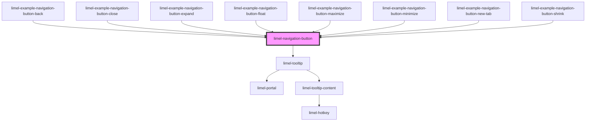

<!-- Auto Generated Below -->

## Overview

To keep navigation patterns consistent across an application, use this
component for certain navigation patterns, such as navigating to fullscreen
or opening an object as a floating card on the side.

These navigation patterns should always look and feel the same way for
end-users, so that they can recognize the buttons quickly and have a fair
expectation of what happens if they are clicked.

By setting the correct type, you get the proper visualization of the
navigation button. The `type` of the button only defines the look and feel
and the interactive behavior of the navigation button. These buttons do not
have any built-in functionality. Thus it is up to you to apply proper
actions or links to them.

The icons are embedded in the component, so it needs no icon set.

## Properties

| Property             | Attribute              | Description                                                                                                                                                                                                                                                                       | Type                                                                                           | Default     |
| -------------------- | ---------------------- | --------------------------------------------------------------------------------------------------------------------------------------------------------------------------------------------------------------------------------------------------------------------------------- | ---------------------------------------------------------------------------------------------- | ----------- |
| `href`               | `href`                 | The URL that the link redirects to. Due to accessibility concerns, and to make the component focusable using keyboard navigation, specifying an `href` will render the component as an `<a>` tag in the DOM. Without the `href`, this component will be rendered as a `<button>`. | `string`                                                                                       | `undefined` |
| `tooltipHelperLabel` | `tooltip-helper-label` | Can be optionally provided to add supplementary information along with the tooltip label. Screen readers announce it as the description of the button.                                                                                                                            | `string`                                                                                       | `undefined` |
| `tooltipLabel`       | `tooltip-label`        | If defined, a tooltip will be shown when the button is hovered or focused. The text is also the accessible name of the button, so set it to something that tells the user what the button does.                                                                                   | `string`                                                                                       | `undefined` |
| `type`               | `type`                 | Please see the examples for usage tips and guidelines.                                                                                                                                                                                                                            | `"back" \| "close" \| "expand" \| "float" \| "maximize" \| "minimize" \| "newTab" \| "shrink"` | `undefined` |

## Dependencies

### Used by

 - [limel-example-navigation-button-back](examples)
 - [limel-example-navigation-button-close](examples)
 - [limel-example-navigation-button-expand](examples)
 - [limel-example-navigation-button-float](examples)
 - [limel-example-navigation-button-maximize](examples)
 - [limel-example-navigation-button-minimize](examples)
 - [limel-example-navigation-button-new-tab](examples)
 - [limel-example-navigation-button-shrink](examples)

### Depends on

- [limel-tooltip](../tooltip)

### Graph

----------------------------------------------

*Built with [StencilJS](https://stenciljs.com/)*
