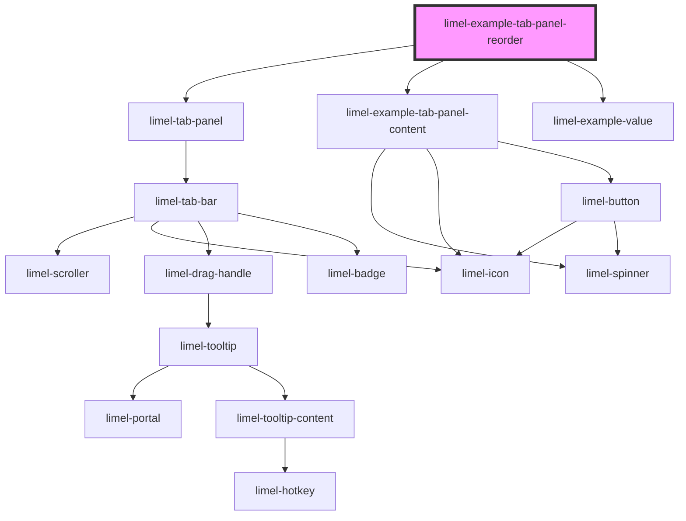

<!-- Auto Generated Below -->

## Overview

Let the user reorder the tabs
Set `allowTabReorder` to give every tab a drag handle, so that the user can
drag the tabs into the order they want. The panel does not change `tabs`
itself. When the user drops a tab in a new place, the `reorderTab` event
tells which tab was moved, and from which position to which. The tab stays
where it was, until the component gives the panel the tabs in their new
order. That is also the place to save the order, if it should be remembered.

The content follows its tab, since each component inside the panel is tied
to its tab by its `id`.

The tabs can be reordered with a mouse and with a touch screen, where the
drag handle is pressed and held for a moment before it is dragged. They
cannot be reordered with the keyboard yet.

## Dependencies

### Depends on

- [limel-tab-panel](..)
- [limel-example-tab-panel-content](.)
- [limel-example-value](../../../examples)

### Graph

----------------------------------------------

*Built with [StencilJS](https://stenciljs.com/)*
