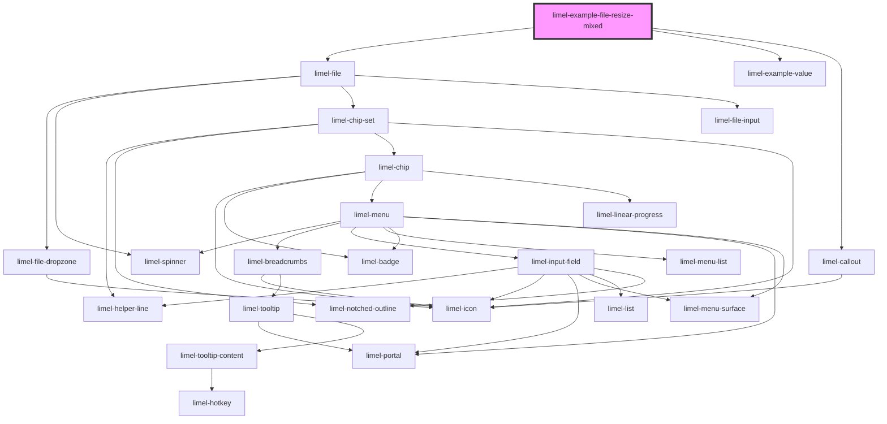

<!-- Auto Generated Below -->

## Overview

Resize in a general file picker

The same `resizeImage` options with the default `accept="*"` — the scenario
unique to a general-purpose picker. Resize degrades gracefully:

- selecting an image resizes and re-encodes it;
- selecting a PDF, archive, document, or SVG passes through untouched —
  only decodable raster images are resized;
- selecting a HEIC/HEIF off Safari emits the original unchanged, because the
  browser cannot decode it.

Inspect the emitted value below: its `filename`, `contentType` and `size`
change only when the file was actually resized.

:::note
HEIC/HEIF images (common from iPhones) cannot be decoded outside Safari, so
they are emitted unchanged. Detect this in your app — for example from the
emitted filename extension, as below — and convert or reject server-side if
needed.
:::

## Dependencies

### Depends on

- [limel-file](..)
- [limel-example-value](../../../examples)
- [limel-callout](../../callout)

### Graph

----------------------------------------------

*Built with [StencilJS](https://stenciljs.com/)*
