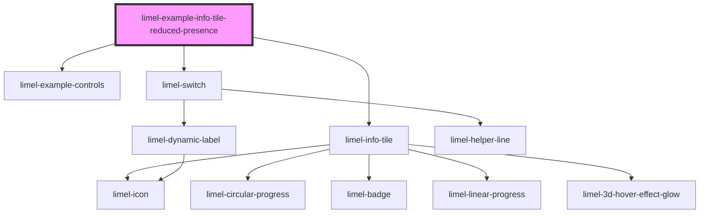

<!-- Auto Generated Below -->

## Overview

Reducing visual presence

Info tiles can have bright colors that draw attention. When several
tiles sit on the same dashboard, the equally-loud visual styling can
overwhelm the user even though most tiles report nothing noteworthy.
For example: "zero customers need your attention today"

:::tip
An info tile should tell the user:
> Hey 👋! Look at me. Here's something you should know about your
> business right now!

not:
> Hey 👋! Look at me. I'm here to show you that nothing important is
> happening right now. Carry on with your work, and check on me
> later if you like.
:::

Set `reducedPresence` to `true` on the tiles whose values are not
currently noteworthy. This is better than hiding the individual tiles.
This way, the tile keeps its position in a grid layout, and also remains
interactive. But is rendered with reduced saturation and opacity,
so the eye is drawn to the tiles that actually warrant attention.
The dimming clears on hover and keyboard focus, so the tile is
still fully readable when the user looks at it.

The example below shows a typical operations dashboard. Four of the
six tiles report something unimportant; the other two report something the
user should look at. Toggle the switch to see how reducing the
presence of the four benign tiles makes the two tiles that actually
need attention stand out.

## Dependencies

### Depends on

- [limel-info-tile](..)
- [limel-example-controls](../../../examples)
- [limel-switch](../../switch)

### Graph

----------------------------------------------

*Built with [StencilJS](https://stenciljs.com/)*
