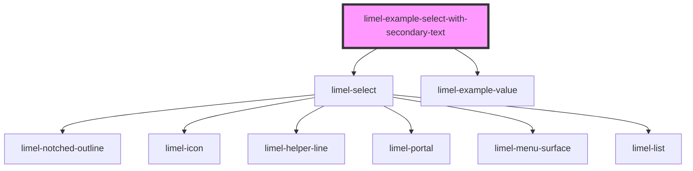

<!-- Auto Generated Below -->

## Overview

Select with secondary text for options
Using a `secondaryText` you can provide additional information about
each option in the list, helping the users to select the right choice.

:::note
1. The secondary text is only visible in the dropdown list,
not on the selected option in the input field.
1. Additionally, on touch screen devices, the secondary text will not
be visible in the dropdown list, since the component uses the "native"
select, which does not have support for additional features like this,
or displaying icons beside the options.
:::

## Dependencies

### Depends on

- [limel-select](..)
- [limel-example-value](../../../examples)

### Graph

----------------------------------------------

*Built with [StencilJS](https://stenciljs.com/)*
