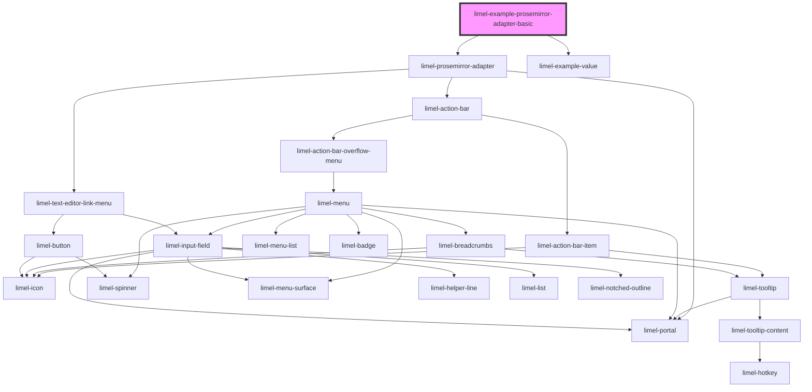

<!-- Auto Generated Below -->

## Overview

Basic example

Try typing and editing text, or copy & paste in some rendered HTML code
from your browser into the editor to see how it is rendered and what you get
as an output value.

## Dependencies

### Depends on

- [limel-prosemirror-adapter](..)
- [limel-example-value](../../../../examples)

### Graph

----------------------------------------------

*Built with [StencilJS](https://stenciljs.com/)*
