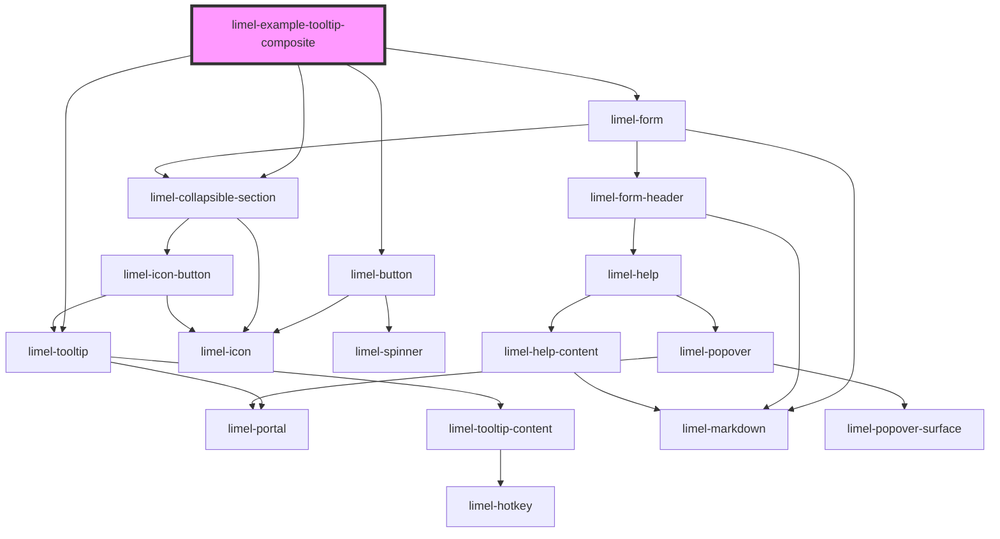

<!-- Auto Generated Below -->

## Overview

Composite

A place to try different combinations of states.

## Properties

| Property | Attribute | Description | Type              | Default     |
| -------- | --------- | ----------- | ----------------- | ----------- |
| `schema` | --        |             | `FormSchema<any>` | `undefined` |

## Dependencies

### Depends on

- [limel-button](../../button)
- [limel-tooltip](..)
- [limel-collapsible-section](../../collapsible-section)
- [limel-form](../../form)

### Graph

----------------------------------------------

*Built with [StencilJS](https://stenciljs.com/)*
