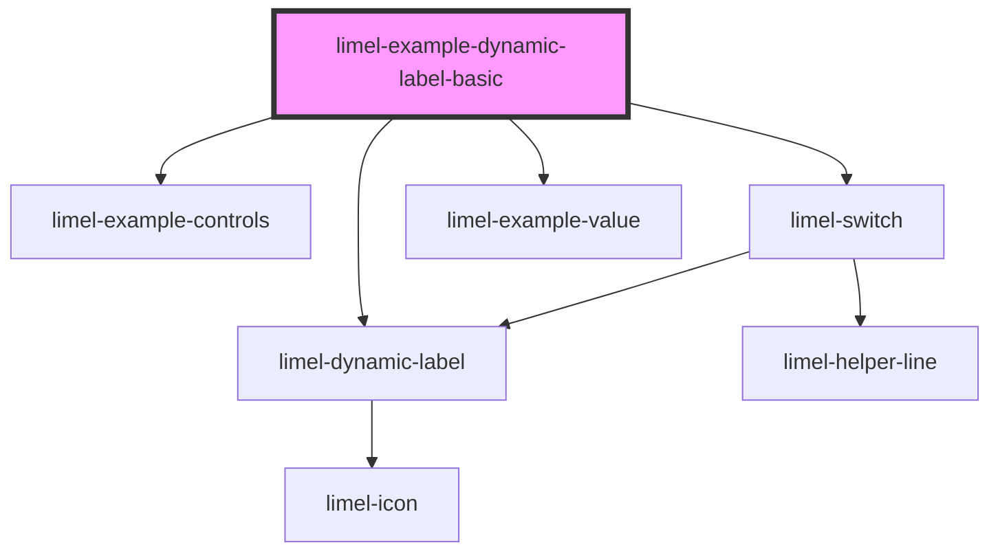

<!-- Auto Generated Below -->

## Overview

Basic example

Switching the value to `true` or `false` will dynamically change the label,
while the default label (including its icon) is ignored.

## Dependencies

### Depends on

- [limel-dynamic-label](..)
- [limel-example-controls](../../../examples)
- [limel-switch](../../switch)
- [limel-example-value](../../../examples)

### Graph

----------------------------------------------

*Built with [StencilJS](https://stenciljs.com/)*
