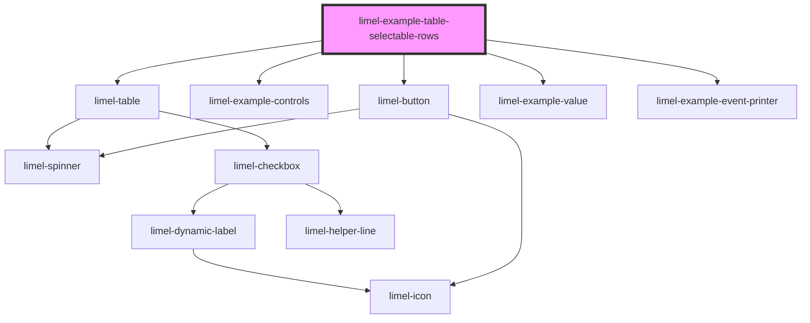

<!-- Auto Generated Below -->

## Overview

Selectable rows with updating aggregates

Set `selectable` to `true` to add a checkbox to the start of each row, and
one in the header that selects all rows.

- When the user ticks or unticks a checkbox, the table emits `select` with
all the rows that are now selected.
- Holding <kbd>Shift</kbd> while clicking a checkbox selects or unselects
all the rows between it and the checkbox that was clicked before.
- The checkbox in the header selects all the rows in `data`, also those on
other pages, or clears the selection. It emits `select` first, and then
`selectAll` with `true` or `false`.

Keep the selection in your own state and give it back to the table as
`selection`. You can also set `selection` yourself, as the buttons below do.
The table finds the selected rows by their `id`, so give every row one.

A click on a checkbox does not activate the row, so selecting and activating
work side by side, as in this example.

The row below the others shows the values given in `aggregates`, each one
under the column with the same `field`. In this example they are worked out
again every time the selection changes, so they describe the selected rows,
or all the rows when none is selected.

## Dependencies

### Depends on

- [limel-table](..)
- [limel-example-controls](../../../examples)
- [limel-button](../../button)
- [limel-example-value](../../../examples)
- [limel-example-event-printer](../../../examples)

### Graph

----------------------------------------------

*Built with [StencilJS](https://stenciljs.com/)*
