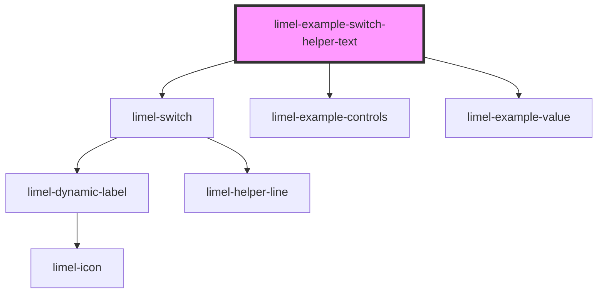

<!-- Auto Generated Below -->

## Overview

With `helperText`

Switch can have a helper text, which is useful when providing
additional information and can clarify functionality of the
switch for the user.

The helper text is displayed when the user interacts with the switch.

## Dependencies

### Depends on

- [limel-switch](..)
- [limel-example-controls](../../../examples)
- [limel-example-value](../../../examples)

### Graph

----------------------------------------------

*Built with [StencilJS](https://stenciljs.com/)*
