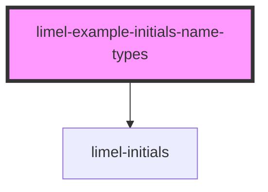

<!-- Auto Generated Below -->

## Overview

Different kinds of names

People and companies are named in different ways, so the component needs
to know what kind of name it is reading. Tell it with `nameType`:

- `default` suits most names: of people, but also of pets, products or
projects. It takes the first letter of the first, the second and the last
word, so a middle name is included: "Anna Maria Svensson" becomes "AMS".
- `company` takes the first letter of the first two words. It skips legal
forms such as "AB", "Oy", "GmbH" or "Ltd", wherever they are in the name,
because they do not tell one company from another. A short first word
written in capitals, such as "TNK", is often how people know the company,
so it is kept whole.
- `initials` is for when you already know which letters to show. They are
shown in uppercase, without spaces or punctuation, and at most three of
them.

Notice that the text gets smaller when the tile shows three letters, so
that they still fit.

## Dependencies

### Depends on

- [limel-initials](..)

### Graph

----------------------------------------------

*Built with [StencilJS](https://stenciljs.com/)*
